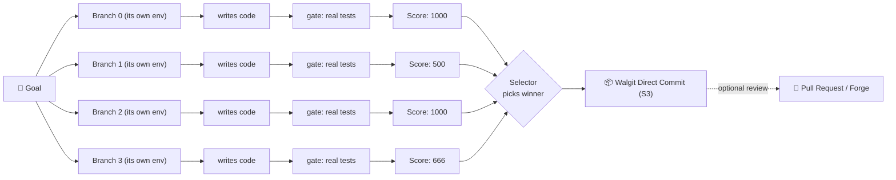

<div align="center">

```text
 ██╗  ██╗  ██████╗  ██╗       ██████╗  ███╗   ██╗
 ██║  ██║ ██╔═══██╗ ██║      ██╔═══██╗ ████╗  ██║
 ███████║ ██║   ██║ ██║      ██║   ██║ ██╔██╗ ██║
 ██╔══██║ ██║   ██║ ██║      ██║   ██║ ██║╚██╗██║
 ██║  ██║ ╚██████╔╝ ███████╗ ╚██████╔╝ ██║ ╚████║
 ╚═╝  ╚═╝  ╚═════╝  ╚══════╝  ╚═════╝  ╚═╝  ╚═══╝
```


# Welcome to Holon 👋

**A library of 200+ WebAssembly capability components, and four ways to run what you compose from them.**

[](rust-toolchain.toml)
[](wit/)
[](https://opensource.org/licenses/MIT)
[](components/)
[-informational)](docs/adr/)

> **What is a Holon?** Coined by philosopher Arthur Koestler (*The Ghost in the Machine*, 1967), a *holon* is an entity that is simultaneously an autonomous, self-regulating **whole** in relation to its sub-parts, and an interdependent **part** of a larger system (a *holarchy*). In natural ecosystems, a cell is an autonomous whole, yet a part of an organism; an organism is a complete individual, yet a part of its species and ecosystem.
>
> In this repository, every WebAssembly component is a holon: self-contained and complete behind its typed WIT boundary, and an autonomous building block of the applications, fleets, and lattices you compose from it.

</div>

---

### ⚡ Quick Start in 60 Seconds

You don't need a heavy control plane or Kubernetes cluster to explore. Compose and run an application locally on your workstation with one command:

```bash
# 1. Compose components into a single root .wasm via WAC
cargo xtask compose link-shortener

# 2. Run it locally on the native host (:3942)
cargo xtask host link-shortener

# 3. Test your live endpoint
curl http://localhost:3942/healthz
```

Or install the standalone prebuilt binaries directly to `~/.holon/bin`:
```bash
curl -fsSL https://raw.githubusercontent.com/markkovari/holon/main/install.sh | sh
```

---

## 🧭 Who is Holon For? (Targeted Personas)

Holon is architected to eliminate repetitive infrastructure across different engineering roles:

| Persona | Why You'll Love Holon | Primary Workflow |
|---|---|---|
| **🛠️ Component & Backend Developers** | Stop writing bespoke auth, KV, rate-limiters, or session layers. Pick modular components, assemble via WIT contracts with zero glue code, and test them in sub-millisecond isolation. | `cargo xtask compose <app>`<br>`cargo xtask host <app>`<br>`components/*/gate.sh` |
| **🌐 Platform & Systems Operators** | Deploy dense, high-performance services to bare metal, VPS, or edge without Kubernetes. Single-process tenancy, zero Docker daemon on the runtime path, and declarative NATS lattices. | `holon node render`<br>`holon fleet render`<br>`systemctl start holon-host` |
| **🤖 AI & Autonomous Agent Engineers** | Run autonomous swarms that write real code against typed boundaries. Every branch runs against a real native test gate; winners land into S3 Git lineage via Walgit without manual PR drag. | `comp-goalrun --checks-url ...`<br>`holon-agentd`<br>`agent-runtime` |
| **🧩 Polyglot & Frontend Engineers** | Build single-artifact applications where client web SPAs (Svelte, React, Vite) and polyglot backends (Rust, Go, Python, C#) are packaged into a unified `.wasm` binary. | `cargo xtask compose <app>`<br>`tools/build-polyglot.sh`<br>`wac plug` |

---

## 🖥️ Technical Specifications & Hardware Profiles

Holon components compile to standard `wasm32-wasip2`, executing on Wasmtime. Because components share memory address spaces safely without OS process overhead, Holon scales from ultra-compact 15g micro-boards to massive compute fleets:

| Profile | Target Hardware | Technical Dimensions & Specs | Deployment Role & Footprint |
|---|---|---|---|
| **🍓 Ultra-Compact Edge** | Raspberry Pi Zero 2 W | **Broadcom BCM2710A1**, 4× Cortex-A53 (1.0 GHz)<br>**512 MB LPDDR2**, 16 GB MicroSD<br>65 × 30 × 5 mm, 15 g, ~1.2 W power | **Edge Leaf & Relays:** `holon-host` with `--no-pool` consumes **~18–25 MB RSS**, leaving >220 MB RAM free. Cold start &lt;5 ms. Ideal for IoT sensors, offline webhook buffering, and 24/7 pulse generation. |
| **🥧 High-Performance Edge** | Raspberry Pi 5 / RK3588 | **Broadcom BCM2712**, 4× Cortex-A76 (2.4 GHz)<br>**4 GB – 16 GB LPDDR4X**, NVMe SSD<br>85 × 56 × 17 mm, 46 g, ~5.0 W power | **Edge Lattice Node:** Multi-tenant host, local edge caching, private NATS lattice participant, and local event bus routing. |
| **💻 Local Workstation** | Apple Silicon (M1–M4), x86_64 Linux, macOS | 4–16+ cores, 8 GB – 64 GB RAM<br>PCIe NVMe SSD, Laptop / Desktop | **Development & Testing:** Instant cold starts (&lt;5 ms), local `xtask host` runtime, memory footprint &lt;30 MB per running application. |
| **⚡ Gate Worker / CI Node** | Dedicated CI Runner, Mac mini, or Bare Metal | 8 – 16+ cores, 16 GB – 32 GB RAM<br>NVMe SSD (fast I/O), 1U Rack / Mini PC | **Test Gates & Swarms:** Runs `comp-checks` with a shared persistent cache (`warm_caches()` in `~/.cache/comp-goalrun/`). Gates 8–64 concurrent builds in 7–10 s flat. |
| **☁️ Production Lattice Node** | Cloud VPS (Hetzner, AWS EC2, DigitalOcean), Bare Metal | 2 – 4 vCPUs, 4 GB – 8 GB RAM<br>Standard Cloud / Bare Metal Server | **Multi-Tenant Serving:** Runs `holon-host` joined to a NATS JetStream lattice. Replaces heavy Kubernetes clusters; serves hundreds of isolated tenant instances on a $10/mo node. |

### 📐 Verified Technical Dimensions & Resource Envelope

Real-world verified measurements running on bare physical hardware (Raspberry Pi Zero 2 W):

```text
Raspberry Pi Zero 2 W (Technical Envelope)
┌──────────────────────────────────────────────┐ ── 30 mm
│ [PWR] [USB-DATA]                     [ACT] █ │
│                                              │
│       Broadcom BCM2710A1 Quad-Core 64-bit    │
│            512 MB LPDDR2 (~3.2 GB/s)         │
│                                              │
│ [MicroSD]                          [MiniHDMI]│
└──────────────────────────────────────────────┘ ──
 ├─────────────────── 65 mm ──────────────────┤   Thickness: 5.2 mm
 Weight: 15 grams | Power Draw: ~1.2 W active | Host RSS: 18-25 MB
```

* **CPU & Architecture:** Broadcom BCM2710A1, 4× Cortex-A53 @ 1.0 GHz (ARMv8-A, pure 64-bit `aarch64`).
* **Memory & Sizing:** 512 MB LPDDR2. Base OS uses ~140 MB; `holon-host` serving a composed application (`link-shortener`, 908 KB `.wasm`) adds only **~18–25 MB RSS**, leaving **>220 MB of available memory** while actively serving HTTP traffic.
* **Power & Thermal:** 5V over micro-USB, drawing ~0.7 W idle, ~1.2 W – 2.0 W under active HTTP load (pure passive cooling).
* **Crucial flag for 512 MB boards:** Pass `--no-pool` to `holon-host` (switches to Wasmtime's on-demand allocator rather than the pooling allocator, avoiding multi-gigabyte virtual address space mmap reservations).
* **Full Technical Specifications:** See [`docs/EDGE.md`](docs/EDGE.md) for complete hardware dimensions (caches, bus speeds, memory limits, and Netplan templates).

---

## 🧰 What Native Tools Do You Need?

Holon components are pure WebAssembly, but the host environment and engineering loop leverage standard native tooling:

### 1. Core Prerequisites (To build and compose)
* **Rust & Cargo** (pinned in `rust-toolchain.toml`, version 1.98.0+):
  ```bash
  curl --proto '=https' --tlsv1.2 -sSf https://sh.rustup.rs | sh
  rustup target add wasm32-wasip2
  ```
* **WAC (WebAssembly Compositions CLI)**:
  Used to resolve and compose WIT dependencies into unified application binaries:
  ```bash
  cargo install wac-cli
  ```
* **Node.js & npm** (v20+):
  Required for building embedded frontend SPAs (`vite build`) and validating interactive architecture maps:
  ```bash
  node --version  # v20.x or v22.x
  ```

### 2. Standalone Holon Binaries (Install via script)
Run our automated multi-platform installer to install prebuilt native binaries into `~/.holon/bin`:
```bash
# Installs holon CLI, holon-host, comp-plug, comp-checks, and holon-relay
curl -fsSL https://raw.githubusercontent.com/markkovari/holon/main/install.sh | sh
```
* `holon`: The CLI for managing nodes, rendering systemd units, inspecting components, and deploying lattices.
* `holon-host`: The native Wasmtime-based host serving WASI p2/p3 components over HTTP and NATS.
* `comp-plug`: The automatic import resolver and linker (wraps `wac`).
* `comp-checks`: The high-concurrency test gate daemon (materializes trees, executes sandboxed test suites).
* `holon-relay`: The pull-to-push event relay driving `sched:timer`, `event:bus`, and `cron:expr`.

### 3. Optional Supporting Infrastructure
* **NATS Server** (`nats-server`): Needed only for Lane 2 (multi-node lattice orchestration) and JetStream RPC.
* **Walgit / S3 Storage**: Any S3-compatible store (Cloudflare R2, MinIO, AWS S3) for object blobs and frictionless Git commit lineage.
* **SurrealDB** (`surreal`): Used by the capability graph (`comp-capgraph`) and agent memory.
* **Hurl** (`hurl`): Used by `components/*/gate.sh` to run declarative HTTP integration tests.

---

## 🌟 What is Holon?

Every backend team endlessly rebuilds the same boring infrastructure:
* Sessions, authentication, and RBAC
* Distributed rate limiting and quota meters
* Idempotency, caching, and audit logging
* Virtual Git code stores, knowledge graphs, and event buses

Holon delivers all of these as **production-ready `wasm32-wasip2` components**, each defined by a typed WIT contract plus a reference implementation.
* **Typed WIT Contracts**: Language-agnostic interfaces. The boundary is enforced by the linker, never by human vigilance.
* **Composition via `wac`**: Connect components into full applications without glue code.
* **Write Once, Deliver Anywhere**: Move from a single local binary to a bare-metal NATS lattice or wasmCloud without changing a single line of your business logic.

---

## The two halves

**The library.** `records:store`, `auth:identity`, `event:bus`, `sched:timer` and
ninety more interfaces, each with a provider and consumers. Contracts are WIT, so
a component is language-agnostic and its boundary is enforced by the linker
rather than by review. `comp-capgraph` derives the graph from the *built
artifacts* — a component's real imports are in its binary, so it cannot drift.

**Delivery.** One hand-authored `apps/<name>.toml`, four backends. Moving between
them is an edit and a different recipe, never a rewrite.

| lane | what runs it | for |
|---|---|---|
| **one box** | `holon-host` + systemd + Caddy | your own machine, no control plane |
| **a lattice** | `holon-host` per node + reconciler + ingress over NATS | several boxes, where *which* box stops being your decision |
| **wasmCloud 1.x** | wadm, over NATS | somebody else's wasmCloud |
| **wasmCloud 2.x** | the runtime-operator, over the Kubernetes API | current wasmCloud — no wadm, no OAM |

On a second machine — a gate worker, or another box to serve from — there is no
checkout to make and nothing to build:

```bash
curl -fsSL https://raw.githubusercontent.com/markkovari/holon/main/install.sh | sh
```

That installs `comp-checks` into `~/.holon/bin`, which is all a machine needs to
run a candidate's checks: the tree arrives in the request, so a worker never has
a copy of the project it is gating — and no Rust, because the toolchain a check
needs is the *gated project's* business, not this one's. `HOLON_ROLE=full` adds
the host, the composer and the loop. Prebuilt for macOS and Linux, arm64 and
x86_64; it builds from source only if there is no binary for the platform, and
says so first.

The gate can then run *there* rather than here. `comp-checks` materialises the
candidate tree from the request, so the second box never clones the project it is
gating — it needs only whatever toolchain the checks themselves name:

```bash
# on the worker, bound to a tailnet address (never 0.0.0.0)
head -c 32 /dev/urandom | base64 > ~/.comp-secrets/checks     # the same file on both
comp-checks --addr 100.64.0.1:8199 --token-file ~/.comp-secrets/checks \
            --allow 'cargo test' --timeout 120

# on the box driving the loop
comp-goalrun --checks-url http://100.64.0.1:8199/check \
             --checks-token-file ~/.comp-secrets/checks …
```

A token is not optional off the loopback and `comp-checks` refuses to start
without one: `--allow` bounds the *command*, not the tree it runs over, and
`cargo test` on a tree an agent wrote runs that tree's `build.rs`.

### A swarm of branches, one box: already fine; many checks at once: was not

`comp-goalrun`'s own `warm_caches()` already gives every branch a **shared,
persistent** `CARGO_HOME`/`CARGO_TARGET_DIR` (`~/.cache/comp-goalrun/…`, paid
once, ever) when it runs `comp-checks` co-located. This is not a hypothetical
fix — it is measured: 8 to 64 concurrent `cargo build`s of one component, each
with a genuinely distinct edit, against that shared `target/`, ran in **7–10 s
flat** on 12 cores, zero failures, no lock-degradation even at 64-way
concurrency far past core count. Isolated per-branch `target/` dirs, for
comparison, plateau around 41–43 s regardless of N in that range — the
difference is entirely cargo's own fingerprint reuse on the shared dir, not
avoided lock contention, and capping each build's own `--jobs` made things
*slower*, not faster: let cargo and the OS arbitrate.

**What was not fine: `comp-checks` itself answered one request at a time**,
full stop — a plain `for stream in listener.incoming()` loop with no
concurrency, independent of caching or core count. Measured: 20 concurrent
2-second checks took 42 s (exactly N × duration — perfectly serial). Now fixed:
each connection runs on its own thread, bounded by `--max-concurrent` (default
256 — generous on purpose, since the data above shows the compile step itself
does not need throttling; it exists as a safety ceiling against a pathological
spike, each waiting connection being one thread). The same 20×2 s test now
finishes in 2 s. A real, pre-existing race this surfaced — two concurrent
first-time requests for the same brand-new commit could corrupt its cached
base tree — is fixed with a lock around just that (rare, cheap) step.

Full measurements, the two wrong theories tried first, and the plan for
distributing across a second machine (not built yet — no second machine to
test it against): [`docs/measure/gate-concurrency.md`](docs/measure/gate-concurrency.md).

For a **second, remote worker box** (the `--checks-url` case below, a separate
machine with no local `warm_caches`), point it at its own persistent cache the
same way, and optionally add [`sccache`](https://github.com/mozilla/sccache)
(plain caching mode — its distributed-compilation mode needs a Linux scheduler
and is unproven for `wasm32-wasip2`) so a cold new box bootstraps faster:

```bash
comp-checks --addr … --token-file … --allow 'cargo test' --timeout 120 \
  --max-concurrent 256 \
  --check-env CARGO_HOME=/var/cache/holon/cargo-home \
  --check-env CARGO_TARGET_DIR=/var/cache/holon/cargo-target \
  --check-env RUSTC_WRAPPER=/usr/local/bin/sccache \
  --check-env SCCACHE_DIR=/var/cache/holon/sccache
```

```bash
cargo xtask compose gate                # components -> one .wasm
```

HTTP is not the only trigger. `sched:timer`, `event:bus` and `cron:expr` are
pull-based by design — which keeps them pure WASI and portable — so `holon-relay`
drives them in every lane, and an app gains a trigger by declaring `[triggers]`
rather than by changing its exported WIT.

See [`docs/SELFHOST.md`](docs/SELFHOST.md) for all four lanes and what each costs.

## Why WebAssembly, and what is native on purpose

Components are the unit of **isolation** — a store name resolves through host-side
state the guest cannot write, so the boundary is a linker boundary rather than a
policy ([ADR-0023](docs/adr/0023-isolation-is-a-linker-boundary.md)) — and the unit
of **composition**: an app is a root component plus everything `wac` pulls in
behind it, derived from its own imports rather than hand-written
([ADR-0087](docs/adr/0087-a-composition-is-derived-not-written.md)).

Only what *must* be native is native, and
[ADR-0095](docs/adr/0095-what-is-allowed-to-be-native.md) is the written test for
admitting anything new: it must need a capability WASI denies a guest — a process,
a raw socket, a held subscription — not a convenience. The host that runs the wasm
(`host/`, wasmtime 45), the reconciler that holds a NATS subscription and a timer
(`reconciler/`), the gate that spawns processes, the relay that holds a clock, and
the CLI. Everything else is a component.

<a id="the-agentic-loop"></a>
<a id="the-agentic-loop--paused-and-kept"></a>
## The autonomous agentic loop — **active and proven**

Holon contains an engineering loop that runs AI agents in parallel over this
substrate: each branch explores the same goal in its own environment, a real test
gate judges every candidate, and a selector lands the winner directly into S3-backed Git
via Walgit (or opens a pull request for human review).



**Active and proven.** The loop is actively used and runs real workloads: nothing is mocked
on the path to a landed change. A real model writes the code (`components/anthropic-provider`),
a real suite gates it (`comp-checks`), and the winner commits directly to S3-backed Git via
**Walgit** without PR ceremony, or opens a PR when human review is requested (`components/github-forge`).
It has delivered multi-part decomposed goals as merged changes on this repository
(dispatch, #220; marketplace, #273; single-part goals #275, #279; dual-mode storage #461; S3 Git lineage #462),
with `comp-goald` and `holon-agentd` actively driving sessions and queues.

**The safety invariant.** A run is only as good as the checks written for it.
Every check runs against the untouched base before any inference budget is spent,
refusing runs where checks pass trivially ([ADR-0081](docs/adr/0081-fitness-fuel-and-what-the-swarm-knows.md),
[ADR-0088](docs/adr/0088-what-a-gate-says-is-what-the-next-attempt-reads.md)).
With symbol-level commutation ([ADR-0099](docs/adr/0099-an-agent-native-code-store.md)) and
S3-backed Git lineage ([ADR-0122](docs/adr/0122-s3-backed-git-via-walgit-for-component-lineage.md)),
swarms explore and commit without locking.

```bash
# CHECKOUT is the repository the loop works ON — not this one.
CHECKOUT=~/src/widgets REPO=acme/widgets bash goal-demo.sh real     # goal → PR
```

## Where to look

**The library**

| | |
|---|---|
| what is using what, and may I change it | `comp-capgraph` — every interface, every import edge, and every app composed from them, derived from the built wasm on each run (`--format json`, `--find <text>`, `--twins`, or the default `surql` projection into the knowledge graph); `docs/CAPABILITY-GRAPH.md` is gone |
| the showcase apps, one file each | [`docs/apps/`](docs/apps/README.md) |
| every other document, and which are generated | [`docs/README.md`](docs/README.md) |
| the original capability-library README (archived) | [`docs/archive/capability-library-readme.md`](docs/archive/capability-library-readme.md) |
| why a component is worth more than a note about one | [ADR-0089](docs/adr/0089-capability-accumulation.md) — reuse enforced by a gate that reads what a candidate actually called |
| how a composition is derived rather than written | [ADR-0087](docs/adr/0087-a-composition-is-derived-not-written.md) — `reconciler/fleet/src/plug.rs` reads a component's imports out of the binary |

**Delivery**

| | |
|---|---|
| the four lanes, and what each costs | [`docs/SELFHOST.md`](docs/SELFHOST.md) |
| the app spec — the only file you write | `apps/<name>.toml`, rendered by `holon node render` |
| the lattice: nodes, a reconciler, an ingress | `fleet.example.toml`, `holon fleet render` |
| triggers that are not HTTP | [ADR-0096](docs/adr/0096-a-pull-contract-needs-a-relay.md) — `holon-relay`, and why push never replaces the sweep |
| what may be native at all | [ADR-0095](docs/adr/0095-what-is-allowed-to-be-native.md) — three questions, and the answer to the third is usually "here is the WIT" |
| what runs today, measured, and honestly missing | [`docs/CURRENT.md`](docs/CURRENT.md) |
| what a hardening sweep found, fixed, and left | [`docs/HARDENING.md`](docs/HARDENING.md) — five failures that wore the return type of a success |

**The reasoning**

| | |
|---|---|
| how the whole system fits, one system at a time, and what each says to the others | [`docs/ARCHITECTURE.md`](docs/ARCHITECTURE.md), and [interactively](docs/architecture/index.html) |
| the decisions, some superseded and kept | [`docs/adr/`](docs/adr/) |
| the one rule everything else applies | [`docs/CURRENT.md`](docs/CURRENT.md#the-one-rule-everything-else-is-an-application-of) |

**The loop** — active, gate-verified, and delivering goals

| | |
|---|---|
| how a run succeeds, and every way it fails | [`docs/SCENARIOS.md`](docs/SCENARIOS.md) |
| the agentic core | `components/{agent-writer,agent-driver,graph-selector}`, `reconciler/goal/src/generation.rs`, `reconciler/goal/src/bin/goalrun.rs` |
| what the swarm remembers | `components/knowledge-memory`, [ADR-0084](docs/adr/0084-two-retrievers-and-an-optimistic-database.md) |
| how two halves of one goal agree | `components/contract-registry`, `reconciler/goal/src/compose.rs`, [ADR-0086](docs/adr/0086-parts-negotiate-a-contract.md) |
| the worklist — goals a person has written | [`.comp/goals/`](.comp/goals/) |
| the browser surface: author a goal, read a run as a graph | [`docs/apps/CONSOLE.md`](docs/apps/CONSOLE.md) — `cargo xtask host console` |

## Status

**The library is the mature half.** Heavily tested across four workspaces. How
many components, how many interfaces have both a provider and a consumer, and how
many applications are composed from them are all counted in
`comp-capgraph`, which
derives them from the built artifacts — it says what the code does rather than what a
list claims, which is the reason the numbers are not copied out to here as well.

**Delivery is newly complete and newly proven.** All four lanes were verified
against real infrastructure rather than asserted — the wasmCloud lanes against a
live wadm 0.21 + wasmCloud 1.6.0 and a runtime-operator 2.8.0 + wash 2.8.0 stack.
The honest edge is that a wasmCloud 2.x release host provides standard WASI plus
`wasmcloud:messaging` and nothing else, so an app importing a `comp:` interface
runs on the first two lanes and is refused at render time on the fourth, with the
reason.

**The loop is active and proven** — see above. It actively delivers decomposed goals as PRs,
powers coding sessions in `agent-runtime` and `holon-agentd`, and gates changes with real test suites.

All internal workspace packages have migrated to the `holon-` prefix per [ADR-0118](docs/adr/0118-the-comp-prefix-is-retired-one-layer-at-a-time.md) and [05-become-holon.md](.comp/goals/05-become-holon.md), leaving only wire protocols (`comp.v1...`) and content-addressed WIT contracts (`comp:store`) intact for compatibility.
