# Architecture

*Last revised after [ADR-0114](adr/0114-an-approval-can-reach-beyond-one-call.md).* Generated from [`architecture/map.mjs`](architecture/map.mjs); do not edit this file, edit the map and run `node docs/architecture/build.mjs`.

A map of the whole repository: the systems it is made of, how each one stands on its own, and what each one says to the others. [`CURRENT.md`](CURRENT.md) goes deeper on the runtime and delivery half and carries the measurements; this page covers every system, including the ones added since (park, the code store, the agent services). Where a map and the code disagree, the code wins.

There is an interactive version of the same map, with every system drawn alone and every correspondence numbered on its line: [`architecture/index.html`](architecture/index.html). Open it in a browser.

## Reading the diagrams

A box is coloured by what it is made of, so the line between sandboxed guest code and native processes shows everywhere.

| Box | Is |
| --- | --- |
| teal | a wasm component, a sandboxed guest |
| orange | a native process |
| violet | a store or a bus |
| blue | a client or a person |
| grey | a written spec, contract or check |
| dashed | a peer outside the system being drawn, or outside this repository |

A solid line is a request and a response over HTTP or gRPC, a dashed line is NATS, a dash-dot line is an artifact moving (an OCI push, a rendered file, a pull request). The arrow points from the one that starts it. On a system's own diagram a number on a line matches a row of the table under it.

## The whole

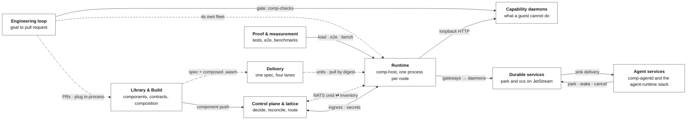

The primary correspondences only; [every correspondence](#every-correspondence) is listed below.

| System | What it is | Reached through |
| --- | --- | --- |
| **[Library & Build](#library--build)** | Wasm components and the WIT contracts between them, composed into one artifact per app. | cargo xtask build · compose · host · test, and the CI workflows |
| **[Delivery](#delivery)** | One app spec rendered for a box, a lattice, wasmCloud 1.x or 2.x. A pull agent keeps boxes current. | holon node render · fleet render · wadm render, then scp and systemctl; publish-apps.yml on every merge to main |
| **[Control plane & lattice](#control-plane--lattice)** | platform-domain decides, comp-reconciler makes the fleet match, comp-ingress is the door. | the holon CLI and the Holon console (both over /api), and comp-ingress for end users |
| **[Runtime](#runtime)** | comp-host: one process per node runs every tenant’s components over wasmtime. | HTTP from comp-ingress or a unit’s own port; start and stop commands from the reconciler |
| **[Capability daemons](#capability-daemons)** | What a guest cannot do, done by small native daemons, each with its own allow-list. | loopback HTTP from a component through wasi:http/outgoing-handler |
| **[Durable services](#durable-services)** | comp-park and comp-vcs: a ticket per outstanding call, and an agent-native code store. | park-gateway and vcs-gateway, tailnet-only by default; comp-agentd calls comp-park directly |
| **[Agent services](#agent-services)** | comp-agentd sessions with approvals, and the agent-runtime stack with its Matrix and desktop fronts. | REST, SSE and gRPC for agentd clients; Element and the GPUI console for agent-runtime |
| **[Engineering loop](#engineering-loop)** | Parallel AI branches, a real test gate, and a selector that opens the winner as a pull request. | holon goal run, and comp-goald draining a project’s queue |
| **[Proof & measurement](#proof--measurement)** | Test suites, end-to-end scripts and benchmarks that drive other machines. | cargo xtask test, e2e/run_all.sh, bench/, and CI |

### State the systems sit on

| State | What lives there | Used by |
| --- | --- | --- |
| **NATS JetStream** | inventory · commands · wRPC KV · tickets · oplog · queues | [Control plane & lattice](#control-plane--lattice), [Runtime](#runtime), [Capability daemons](#capability-daemons), [Durable services](#durable-services), [Engineering loop](#engineering-loop) |
| **SurrealDB** | knowledge graph · run traces code-store graph · kv backend | [Library & Build](#library--build), [Runtime](#runtime), [Durable services](#durable-services), [Engineering loop](#engineering-loop) |
| **S3 / R2** | object bytes · backups presigned photo uploads | [Runtime](#runtime), [Capability daemons](#capability-daemons) |
| **OCI registry** | components and composed apps pulled by digest (GHCR) | [Library & Build](#library--build), [Delivery](#delivery) |
| **Git (GitHub)** | source · PRs · goals as prose apps.lock on the deploy branch | [Library & Build](#library--build), [Delivery](#delivery), [Engineering loop](#engineering-loop), [Proof & measurement](#proof--measurement) |
| **LLM providers** | Anthropic · OpenAI-compatible local mlx_lm · Ollama | [Agent services](#agent-services), [Engineering loop](#engineering-loop) |
| **Local disk** | SQLite kv · state dirs event logs · checkpoints | [Control plane & lattice](#control-plane--lattice), [Runtime](#runtime), [Agent services](#agent-services) |

### Who uses it

| Who | How | Systems |
| --- | --- | --- |
| **Developers &amp; operators** | holon CLI · cargo xtask · git | [Library & Build](#library--build), [Delivery](#delivery), [Control plane & lattice](#control-plane--lattice), [Engineering loop](#engineering-loop) |
| **End users &amp; callers** | browsers and HTTP clients, via the ingress | [Control plane & lattice](#control-plane--lattice), [Runtime](#runtime) |
| **Agent clients** | bots · scripts · UIs over REST, SSE, gRPC | [Agent services](#agent-services) |
| **Element (Matrix)** | talk to agents, vote on approvals | [Agent services](#agent-services) |

## The systems

### Library & Build

A library of capability components, each a WIT contract plus a reference implementation, built to wasm32-wasip2. An app is a root component plus whatever comp-plug finds behind its imports: nothing is wired by hand, and the graph is read off the built binaries so it cannot drift.

**Reached through** cargo xtask build · compose · host · test, and the CI workflows.

```mermaid
%%{init: {"flowchart": {"wrappingWidth": 360}}}%%
flowchart LR
  classDef wasm fill:#e1f3ef,stroke:#0a6a5f,color:#10231f
  classDef native fill:#fbecdc,stroke:#954709,color:#2b1704
  classDef store fill:#eae7fa,stroke:#4a3fb0,color:#17123f
  classDef actor fill:#e4ebf7,stroke:#2a4977,color:#0f1d33
  classDef spec fill:#eef1f5,stroke:#465160,color:#1b2028
  classDef ext fill:#ffffff,stroke:#667180,color:#1b2028,stroke-dasharray:5 4
  classDef ghost fill:#ffffff,stroke:#667180,color:#1b2028,stroke-dasharray:4 3
  n_wit["<b>WIT contracts</b><br/>wit/ · every interface the repo defines<br/>a changed shape needs a new version"]:::spec
  n_comps["<b>Components</b><br/>components/ · wasm32-wasip2 crates<br/>the *-domain ones are the apps"]:::wasm
  n_capgraph["<b>comp-capgraph</b><br/>what imports what, read off<br/>the built wasm · + comp-catalog"]:::native
  n_spec["<b>App spec</b><br/>apps/#lt;name#gt;.toml, one per app<br/>the one hand-written file"]:::spec
  n_plug["<b>comp-plug</b><br/>derives a composition from<br/>the binary’s real imports (wac)"]:::native
  n_composed["<b>Composed artifact</b><br/>one .wasm per app<br/>named by its digest"]:::wasm
  n_guards["<b>Contract guards</b><br/>every import has a provider<br/>bounded guest writes"]:::spec
  n_oci["<b>comp-oci</b><br/>push and pull by digest<br/>ghcr.io/#lt;owner#gt;/holon/#lt;name#gt;"]:::native
  n_g_del(["<b>Delivery</b><br/>renders the spec"]):::ghost
  n_g_loop(["<b>Engineering loop</b><br/>writes components"]):::ghost
  n_g_proof(["<b>Proof #amp; measurement</b><br/>cargo test"]):::ghost
  n_g_cp(["<b>Control plane</b><br/>platform-domain"]):::ghost
  n_g_run(["<b>Runtime</b><br/>comp-host"]):::ghost
  n_g_oci(["<b>OCI registry</b><br/>GHCR"]):::ghost
  n_g_sur(["<b>SurrealDB</b><br/>knowledge graph"]):::ghost
  n_wit -- "contract" --> n_comps
  n_comps -- "built wasm" --> n_capgraph
  n_comps -- "built wasm" --> n_plug
  n_spec -- "root" --> n_plug
  n_plug -- "compose" --> n_composed
  n_composed -- "push" --> n_oci
  n_guards -- "checks" --> n_plug
  n_spec -- "1 · app spec" --> n_g_del
  n_g_loop -- "2 · PRs · plug" --> n_comps
  n_g_proof -- "3 · cargo test" --> n_guards
  n_composed -- "4 · push .wasm" --> n_g_cp
  n_composed -- "5 · xtask host" --> n_g_run
  n_oci -- "6 · OCI" --> n_g_oci
  n_capgraph -- "7 · surql" --> n_g_sur
  linkStyle 5 stroke-dasharray:9 3 2 3
  linkStyle 7 stroke-dasharray:9 3 2 3
  linkStyle 8 stroke-dasharray:9 3 2 3
  linkStyle 12 stroke-dasharray:9 3 2 3
```

|  | Here |  | Peer | Over | What crosses | Decided in |
| --- | --- | --- | --- | --- | --- | --- |
| 1 | apps/&lt;name&gt;.toml | → | [Delivery](#delivery) holon … render | file | A pure function from the spec to systemd units, env files and a Caddy route; wadm Applications for lanes 3 and 4. | [0021](adr/0021-there-is-no-kubernetes.md) |
| 2 | components | ← | [Engineering loop](#engineering-loop) comp-goalrun | git · library call | New components land as pull requests. reconciler/fleet/src/plug.rs composes a candidate in-process, with the wiring and the gaps as values. | [0087](adr/0087-a-composition-is-derived-not-written.md) · [0089](adr/0089-capability-accumulation.md) |
| 3 | contract guards | ← | [Proof & measurement](#proof--measurement) suites | cargo test | contracts.rs (every import has a provider), witsurface.rs (shape moved means version moved), guestio.rs (no unbounded guest write). |  |
| 4 | composed .wasm | → | [Control plane & lattice](#control-plane--lattice) platform-domain | HTTP | POST /api/components?id=…, application/wasm. Reflection is the validation; a save that removes an export needs ?force=true. | [0006](adr/0006-artifacts-are-digest-pinned-oci.md) |
| 5 | composed .wasm | → | [Runtime](#runtime) comp-host | process | cargo xtask host &lt;app&gt; runs a composed artifact on comp-host, for development. |  |
| 6 | comp-oci | → | OCI registry registry | OCI | Push and pull by digest. A tag is a human convenience and is never what gets deployed. | [0006](adr/0006-artifacts-are-digest-pinned-oci.md) · [0024](adr/0024-artifacts-are-content-addressed.md) |
| 7 | comp-capgraph | → | SurrealDB knowledge graph | SurrealQL | The default surql projection of every interface, import edge and composed app into the knowledge graph. | [0097](adr/0097-a-derived-file-is-a-liability.md) · [0091](adr/0091-one-store-one-schema.md) |
|  | comp-plug · comp-oci | → | [Delivery](#delivery) publish-apps.yml | CI | On every merge to main: build the components, derive each app’s composition with comp-plug, push one artifact per app by digest. | [0087](adr/0087-a-composition-is-derived-not-written.md) · [0006](adr/0006-artifacts-are-digest-pinned-oci.md) |

**What keeps it apart**

- Nothing here serves traffic: this is what is built and checked, then handed on as a digest.
- A component’s real imports are in its binary, so the capability graph is derived from the artifacts rather than kept in a list ([ADR-0097](adr/0097-a-derived-file-is-a-liability.md)).
- Adding a function to a WIT interface is compatible; adding a variant case or a record field is not, and witsurface.rs fails when a shape moves without its version.

**Where it lives** [`wit/`](../wit/) · [`components/`](../components/) · [`xtask/`](../xtask/) · [`reconciler/fleet/src/plug.rs`](../reconciler/fleet/src/plug.rs) · [`reconciler/oci/`](../reconciler/oci/) · [`reconciler/fleet/src/bin/plug.rs`](../reconciler/fleet/src/bin/plug.rs) · [`reconciler/fleet/src/bin/oci.rs`](../reconciler/fleet/src/bin/oci.rs) · [`reconciler/goal/src/bin/capgraph.rs`](../reconciler/goal/src/bin/capgraph.rs) · [`reconciler/goal/src/bin/catalog.rs`](../reconciler/goal/src/bin/catalog.rs)

### Delivery

One hand-written apps/&lt;name&gt;.toml is rendered for four lanes: a single box, a lattice, wasmCloud 1.x or wasmCloud 2.x. Moving between them is an edit and a different renderer, never a rewrite. CI publishes composed artifacts by digest; an agent on each box pulls them.

**Reached through** holon node render · fleet render · wadm render, then scp and systemctl; publish-apps.yml on every merge to main.

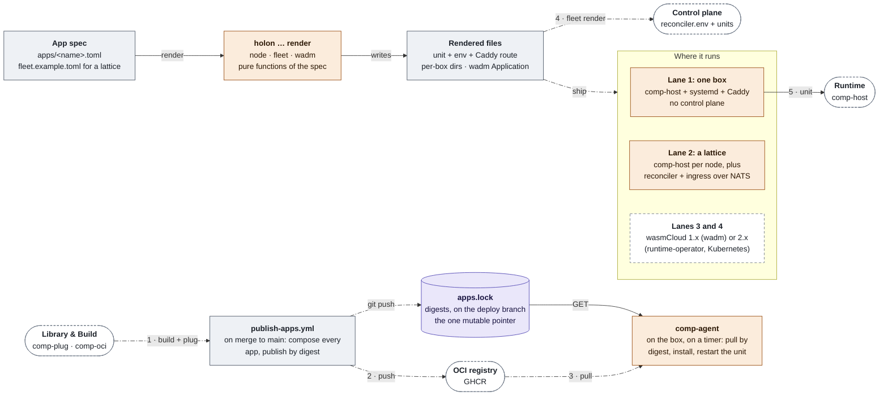

|  | Here |  | Peer | Over | What crosses | Decided in |
| --- | --- | --- | --- | --- | --- | --- |
| 1 | publish-apps.yml | ← | [Library & Build](#library--build) comp-plug · comp-oci | CI | On every merge to main: build the components, derive each app’s composition with comp-plug, push one artifact per app by digest. | [0087](adr/0087-a-composition-is-derived-not-written.md) · [0006](adr/0006-artifacts-are-digest-pinned-oci.md) |
| 2 | publish-apps.yml | → | OCI registry registry | OCI | One composed artifact per app, named by its digest. | [0006](adr/0006-artifacts-are-digest-pinned-oci.md) |
| 3 | comp-agent | ← | OCI registry registry | OCI | The agent pulls by digest, never by tag, and writes down the installed digest. | [0006](adr/0006-artifacts-are-digest-pinned-oci.md) |
| 4 | holon fleet render | → | [Control plane & lattice](#control-plane--lattice) reconciler · ingress | file | One directory per box holding its units and, on the control box, reconciler.env (with PLATFORM_SECRET to fill in). | [0021](adr/0021-there-is-no-kubernetes.md) |
| 5 | lanes 1–2 | → | [Runtime](#runtime) comp-host | systemd | A rendered unit runs comp-host; comp-agent restarts it when apps.lock names a new digest. |  |
|  | holon … render | ← | [Library & Build](#library--build) apps/&lt;name&gt;.toml | file | A pure function from the spec to systemd units, env files and a Caddy route; wadm Applications for lanes 3 and 4. | [0021](adr/0021-there-is-no-kubernetes.md) |

**What keeps it apart**

- Pull, not push: comp-agent has no inbound port and the box holds no CI credential, so nothing reaches in from outside.
- The one mutable pointer is which commit of apps.lock is current, a branch in git whose history is the deploy history. Nothing references a tag ([ADR-0006](adr/0006-artifacts-are-digest-pinned-oci.md)).
- A generated file never makes an app public: access = "tailnet" is the default and is left alone on purpose.
- comp-agent only updates apps the box already has a unit for; adding an app stays a deliberate operator step.

**Where it lives** [`apps/*.toml`](../apps/) · [`cli/src/selfhost.rs`](../cli/src/selfhost.rs) · [`cli/src/fleet.rs`](../cli/src/fleet.rs) · [`cli/src/wadm.rs`](../cli/src/wadm.rs) · [`reconciler/daemons/agent/`](../reconciler/daemons/agent/) · [`.github/workflows/publish-apps.yml`](../.github/workflows/publish-apps.yml) · [`docs/SELFHOST.md`](../docs/SELFHOST.md)

### Control plane & lattice

platform-domain, itself a wasm app, keeps orgs, the catalogue, deployments and secrets. comp-reconciler diffs desired against observed and sends commands over NATS; comp-ingress routes HTTP by Host header from inventory. Bare metal joined by NATS, with no Kubernetes on the runtime path.

**Reached through** the holon CLI and the Holon console (both over /api), and comp-ingress for end users.

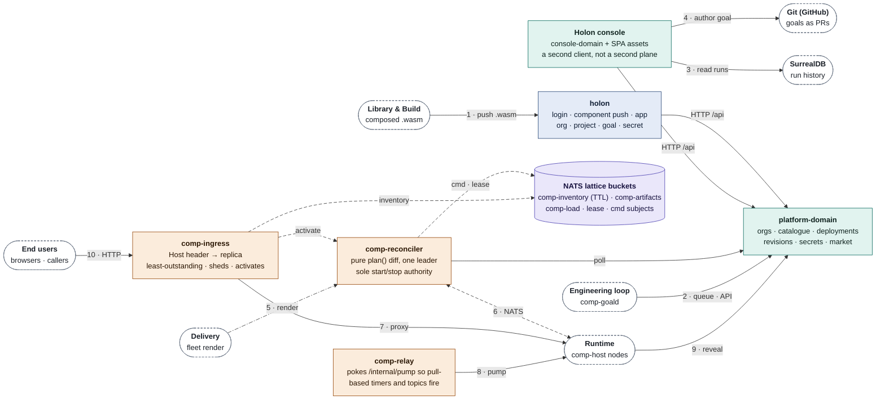

|  | Here |  | Peer | Over | What crosses | Decided in |
| --- | --- | --- | --- | --- | --- | --- |
| 1 | platform-domain | ← | [Library & Build](#library--build) composed .wasm | HTTP | POST /api/components?id=…, application/wasm. Reflection is the validation; a save that removes an export needs ?force=true. | [0006](adr/0006-artifacts-are-digest-pinned-oci.md) |
| 2 | platform-domain | ← | [Engineering loop](#engineering-loop) comp-goald | HTTP | The project’s goal queue and events under /api/projects/{p}/… A person still starts every goal. | [0082](adr/0082-a-project-owns-a-repo-and-a-queue.md) |
| 3 | console-domain | → | SurrealDB knowledge graph | HTTP | knowledge:graph/store: the run view reads the merged store directly. Run history is not control-plane data. | [0091](adr/0091-one-store-one-schema.md) · [0092](adr/0092-a-run-leaves-a-trace.md) |
| 4 | console-domain | → | Git (GitHub) forge | HTTP | git:forge/repo: a goal’s spec is prose in git, so authoring one from the browser is a handful of HTTP calls that open a pull request. | [0082](adr/0082-a-project-owns-a-repo-and-a-queue.md) · [0092](adr/0092-a-run-leaves-a-trace.md) |
| 5 | reconciler · ingress | ← | [Delivery](#delivery) holon fleet render | file | One directory per box holding its units and, on the control box, reconciler.env (with PLATFORM_SECRET to fill in). | [0021](adr/0021-there-is-no-kubernetes.md) |
| 6 | comp-reconciler | ⇄ | [Runtime](#runtime) node agent | NATS | Commands on comp.v1.&lt;lattice&gt;.cmd.&lt;node&gt;.&lt;verb&gt;, request and reply, so “started” means “will serve”. Each node answers with a full inventory snapshot in KV comp-inventory, which expires on its own. | [0021](adr/0021-there-is-no-kubernetes.md) · [0022](adr/0022-desired-state-is-a-manifest.md) · [0058](adr/0058-snapshots-compress-and-parses-are-reused.md) |
| 7 | comp-ingress | → | [Runtime](#runtime) HTTP listener | HTTP | Proxies by Host header straight to a node on the tailnet; least outstanding requests, sheds load past max_inflight. | [0029](adr/0029-one-address-in-front-of-n-replicas.md) · [0041](adr/0041-the-ingress-sheds-load.md) |
| 8 | comp-relay | → | [Runtime](#runtime) tenant apps | HTTP | Pokes an app’s \[triggers\] pump (/internal/pump) on an interval so pull-based timers, topics and cron fire. | [0096](adr/0096-a-pull-contract-needs-a-relay.md) |
| 9 | platform-domain | ← | [Runtime](#runtime) comp:secrets/reader | HTTP | reveal fetches the plaintext on first use with a single-use token; a captured fetch is spent. The guest never holds a reference. | [0051](adr/0051-the-secret-reader.md) · [0071](adr/0071-a-captured-fetch-is-spent.md) |
| 10 | comp-ingress | ← | End users &amp; callers browsers · callers | HTTPS | Caddy terminates TLS for apps declared access = "public"; everything else is reachable on the tailnet only. | [0029](adr/0029-one-address-in-front-of-n-replicas.md) |
|  | comp-reconciler | → | [Control plane & lattice](#control-plane--lattice) platform-domain | HTTP · inside | Polls /api/internal/{revisions, status, pending-pushes, artifact, pushed, fetch-token} with x-platform-secret. Internal to the control plane. | [0022](adr/0022-desired-state-is-a-manifest.md) |
|  | comp-ingress | → | [Control plane & lattice](#control-plane--lattice) comp-reconciler | NATS · inside | An activate command when a scaled-to-zero app gets its first request; one activation per host at a time. Internal to the control plane. | [0042](adr/0042-scale-to-zero-and-back.md) |
|  | platform · reconciler · ingress | ← | [Proof & measurement](#proof--measurement) e2e fleets | NATS · HTTP | Whole fleets in tests: several manifests on one fleet, two reconcilers with one leader, two ingresses and one dies. | [0035](adr/0035-losing-a-machine.md) |

**What keeps it apart**

- comp-reconciler is the only process that can start code on every node. It holds no business logic, no database and no user concept, so it stays small enough to audit in one sitting.
- The ingress needs no platform credential: its routing table comes from inventory, so it keeps routing while the control plane is down.
- Admission fails closed: 429 above max-placement-lag, 503 when the reconciler’s report goes stale.
- Only one reconciler acts at a time, decided by a lease in the store; a standby takes over within the TTL plus one interval.

**Where it lives** [`components/platform-domain`](../components/platform-domain) · [`components/console-domain`](../components/console-domain) · [`reconciler/src/main.rs`](../reconciler/src/main.rs) · [`reconciler/src/plan.rs`](../reconciler/src/plan.rs) · [`reconciler/src/bin/ingress.rs`](../reconciler/src/bin/ingress.rs) · [`reconciler/daemons/relay/`](../reconciler/daemons/relay/) · [`reconciler/daemons/backup/`](../reconciler/daemons/backup/) · [`lattice/src/`](../lattice/src/)

### Runtime

comp-host is a native server that runs any composed component over wasmtime 45, serving WASI p2 and p3. Without --lattice-nats it serves one component; with it, instances arrive as start commands and the process holds every tenant on the node at once.

**Reached through** HTTP from comp-ingress or a unit’s own port; start and stop commands from the reconciler.

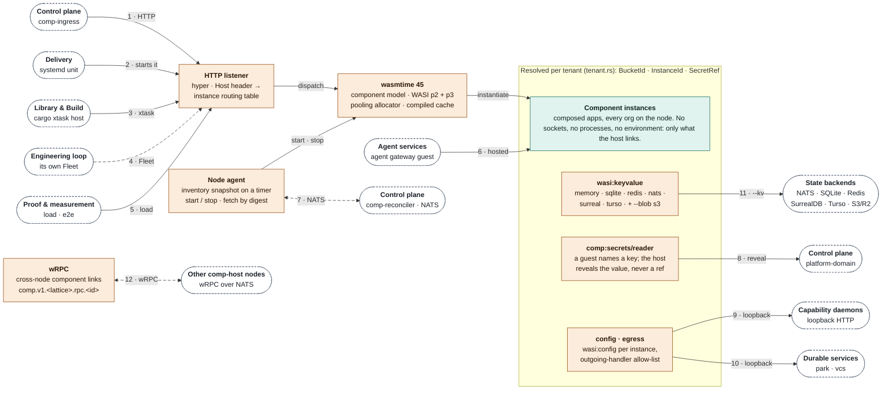

|  | Here |  | Peer | Over | What crosses | Decided in |
| --- | --- | --- | --- | --- | --- | --- |
| 1 | HTTP listener | ← | [Control plane & lattice](#control-plane--lattice) comp-ingress | HTTP | Proxies by Host header straight to a node on the tailnet; least outstanding requests, sheds load past max_inflight. | [0029](adr/0029-one-address-in-front-of-n-replicas.md) · [0041](adr/0041-the-ingress-sheds-load.md) |
| 2 | comp-host | ← | [Delivery](#delivery) lanes 1–2 | systemd | A rendered unit runs comp-host; comp-agent restarts it when apps.lock names a new digest. |  |
| 3 | comp-host | ← | [Library & Build](#library--build) composed .wasm | process | cargo xtask host &lt;app&gt; runs a composed artifact on comp-host, for development. |  |
| 4 | comp-host | ← | [Engineering loop](#engineering-loop) comp-goalrun | NATS · HTTP | comp-goalrun stands up its own Fleet (NATS, hosts, the gate’s runner) for the run and drives apps on it over HTTP. |  |
| 5 | comp-host | ← | [Proof & measurement](#proof--measurement) bench · e2e | HTTP | Open-loop load and failure drills against real nodes: losing a machine, overload, cold start, many tenants. | [0035](adr/0035-losing-a-machine.md) · [0036](adr/0036-open-loop-stress-and-a-correction.md) |
| 6 | comp-host | ← | [Agent services](#agent-services) agent gateway | lattice | The gateway is one generic wasm component deployed once per agent; it forwards W3C traceparent both ways. |  |
| 7 | node agent | ⇄ | [Control plane & lattice](#control-plane--lattice) comp-reconciler | NATS | Commands on comp.v1.&lt;lattice&gt;.cmd.&lt;node&gt;.&lt;verb&gt;, request and reply, so “started” means “will serve”. Each node answers with a full inventory snapshot in KV comp-inventory, which expires on its own. | [0021](adr/0021-there-is-no-kubernetes.md) · [0022](adr/0022-desired-state-is-a-manifest.md) · [0058](adr/0058-snapshots-compress-and-parses-are-reused.md) |
| 8 | comp:secrets/reader | → | [Control plane & lattice](#control-plane--lattice) platform-domain | HTTP | reveal fetches the plaintext on first use with a single-use token; a captured fetch is spent. The guest never holds a reference. | [0051](adr/0051-the-secret-reader.md) · [0071](adr/0071-a-captured-fetch-is-spent.md) |
| 9 | wasi:http outgoing | → | [Capability daemons](#capability-daemons) comp-\* | loopback HTTP | A component dials its daemon through wasi:http/outgoing-handler; the address is given by wasi:config/store. The daemon alone holds the syscall. | [0095](adr/0095-what-is-allowed-to-be-native.md) |
| 10 | park / vcs guests | → | [Durable services](#durable-services) gateways · comp-park · comp-vcs | loopback HTTP | park-store and vcs-store are guests whose every call is one HTTP request to their daemon. | [0100](adr/0100-a-parked-turn-is-a-record-not-a-held-thread.md) · [0099](adr/0099-an-agent-native-code-store.md) |
| 11 | wasi:keyvalue | → | NATS JetStream state backends | --kv | --kv memory \| sqlite \| redis \| nats \| surreal \| turso; the wasm is identical for every backend. A lattice node defaults to nats, the only backend where two replicas share a store. | [0027](adr/0027-a-spread-app-needs-a-shared-store.md) · [0057](adr/0057-the-latency-column-was-arithmetic.md) |
| 11 | blob-store | → | S3 / R2 bucket | S3 API | --blob s3 puts object bytes in S3, R2 or MinIO; keyed state stays on --kv. | [0101](adr/0101-state-can-live-somewhere-else.md) |
| 12 | wRPC | ⇄ | [Runtime](#runtime) other nodes | NATS | Cross-node component links as wRPC on comp.v1.&lt;lattice&gt;.rpc.&lt;instance&gt;; one call costs about 57 µs. | [0028](adr/0028-cross-node-calls-are-wrpc.md) · [0074](adr/0074-the-split-graph-still-works.md) |
|  | tenant apps | ← | [Control plane & lattice](#control-plane--lattice) comp-relay | HTTP | Pokes an app’s \[triggers\] pump (/internal/pump) on an interval so pull-based timers, topics and cron fire. | [0096](adr/0096-a-pull-contract-needs-a-relay.md) |

**What keeps it apart**

- Isolation is a linker boundary, not a process boundary: between two tenants there is no OS process, only wasmtime’s sandbox and the newtypes in tenant.rs ([ADR-0023](adr/0023-isolation-is-a-linker-boundary.md)).
- A name is a real boundary only if host-side state the guest cannot write chose it, and the guest has no second path into the namespace.
- Guests get config from wasi:config per instance, never from the process environment, which in a shared host would be a cross-tenant read.
- A guest names a secret key and never a reference; the host reveals the value on a single-use fetch ([ADR-0051](adr/0051-the-secret-reader.md), 0071).

**Where it lives** [`host/src/main.rs`](../host/src/main.rs) · [`host/src/tenant.rs`](../host/src/tenant.rs) · [`host/src/kv.rs`](../host/src/kv.rs) · [`host/src/secrets.rs`](../host/src/secrets.rs) · [`host/src/rpc.rs`](../host/src/rpc.rs) · [`host/src/agent.rs`](../host/src/agent.rs) · [`host/wit/host.wit`](../host/wit/host.wit)

### Capability daemons

Watching a directory, scanning a LAN, running ffmpeg or a gate: a wasm32-wasip2 component has no watch syscall, no raw socket, no process. Each of these is a small native daemon, one per capability, which the component reaches over loopback HTTP; its address comes from wasi:config.

**Reached through** loopback HTTP from a component through wasi:http/outgoing-handler.

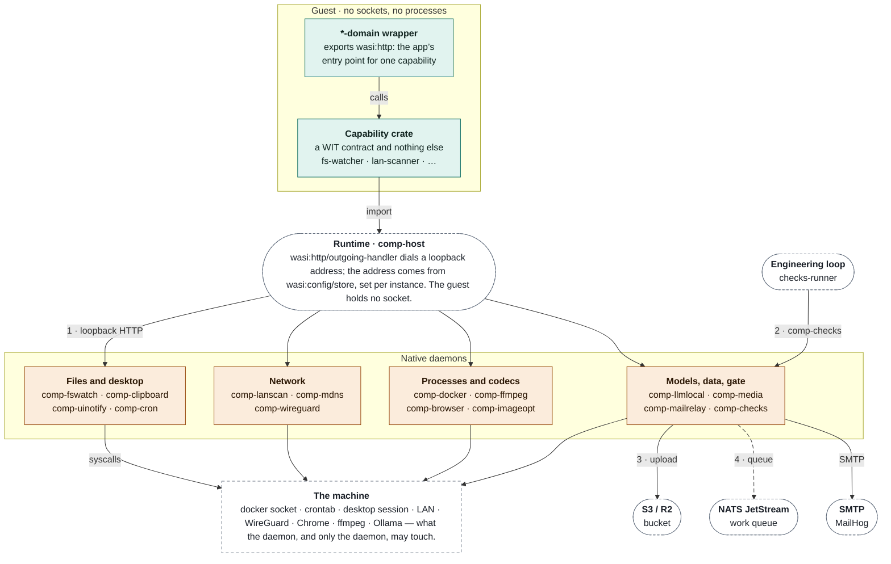

|  | Here |  | Peer | Over | What crosses | Decided in |
| --- | --- | --- | --- | --- | --- | --- |
| 1 | comp-\* | ← | [Runtime](#runtime) wasi:http outgoing | loopback HTTP | A component dials its daemon through wasi:http/outgoing-handler; the address is given by wasi:config/store. The daemon alone holds the syscall. | [0095](adr/0095-what-is-allowed-to-be-native.md) |
| 2 | comp-checks | ← | [Engineering loop](#engineering-loop) checks-runner | HTTP | Posts the candidate tree over a base tree keyed by commit id (an unknown commit is asked for with 409) and gets the whole check vector back. | [0081](adr/0081-fitness-fuel-and-what-the-swarm-knows.md) |
| 3 | comp-media | → | S3 / R2 bucket | presigned HTTP | Photos too big for a guest’s 64 MiB go straight to object storage. | [0098](adr/0098-photos-live-in-object-storage.md) |
| 4 | comp-media | → | NATS JetStream work queue | JetStream | Evaluation is a work queue on the machine with the GPU. | [0098](adr/0098-photos-live-in-object-storage.md) |

**What keeps it apart**

- Each daemon is its own process with its own allow-list and its own blast radius: no shared daemon, no shared allow-list ([ADR-0095](adr/0095-what-is-allowed-to-be-native.md)).
- They bind loopback. comp-checks bounds the command with --allow but not the tree it runs over, so off loopback it refuses to start without a token.
- A missing dependency (Docker, Ollama, Chrome, ffmpeg, a desktop session) is reported as unavailable, never answered with a plausible constant.
- The twelve [ADR-0095](adr/0095-what-is-allowed-to-be-native.md) daemons are each their own Cargo package, with one heavy crate and the shared comp-daemon-kit, so building or shipping one compiles none of the others ([ADR-0115](adr/0115-the-reconciler-is-a-workspace-of-single-purpose-packages.md)).

**Where it lives** [`reconciler/daemons/kit/`](../reconciler/daemons/kit/) · [`reconciler/daemons/fswatch/`](../reconciler/daemons/fswatch/) · [`reconciler/daemons/browser/`](../reconciler/daemons/browser/) · [`reconciler/daemons/docker/`](../reconciler/daemons/docker/) · [`reconciler/daemons/clipboard/`](../reconciler/daemons/clipboard/) · [`reconciler/daemons/imageopt/`](../reconciler/daemons/imageopt/) · [`reconciler/daemons/lanscan/`](../reconciler/daemons/lanscan/) · [`reconciler/daemons/llmlocal/`](../reconciler/daemons/llmlocal/) · [`reconciler/daemons/mdns/`](../reconciler/daemons/mdns/) · [`reconciler/daemons/cron/`](../reconciler/daemons/cron/) · [`reconciler/daemons/uinotify/`](../reconciler/daemons/uinotify/) · [`reconciler/daemons/ffmpeg/`](../reconciler/daemons/ffmpeg/) · [`reconciler/daemons/wireguard/`](../reconciler/daemons/wireguard/) · [`reconciler/daemons/media/`](../reconciler/daemons/media/) · [`reconciler/daemons/mailrelay/`](../reconciler/daemons/mailrelay/) · [`reconciler/src/bin/checks.rs`](../reconciler/src/bin/checks.rs)

### Durable services

Two services on NATS JetStream that other components call over HTTP. comp-park records an outstanding call so no thread has to wait for its answer, and comp-resume delivers what came back. comp-vcs stores code as an oplog of commutative, symbol-level patches.

**Reached through** park-gateway and vcs-gateway, tailnet-only by default; comp-agentd calls comp-park directly.

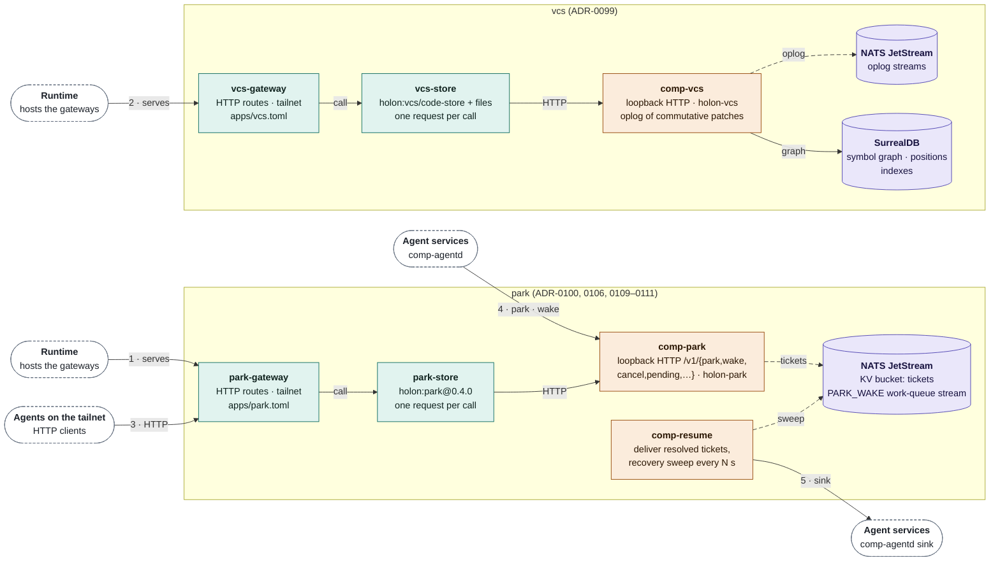

|  | Here |  | Peer | Over | What crosses | Decided in |
| --- | --- | --- | --- | --- | --- | --- |
| 1, 2 | gateways · comp-park · comp-vcs | ← | [Runtime](#runtime) park / vcs guests | loopback HTTP | park-store and vcs-store are guests whose every call is one HTTP request to their daemon. | [0100](adr/0100-a-parked-turn-is-a-record-not-a-held-thread.md) · [0099](adr/0099-an-agent-native-code-store.md) |
| 3 | gateways | ← | Agent clients agents on the tailnet | HTTP | The gateways are the only door: tailnet access, optional token. | [0099](adr/0099-an-agent-native-code-store.md) · [0100](adr/0100-a-parked-turn-is-a-record-not-a-held-thread.md) |
| 4 | comp-park | ← | [Agent services](#agent-services) comp-agentd | HTTP | Parks an approval (correlation = call id, replay unsafe, deadline = the approval timeout), answers it, cancels it. Opt-in with --park-url. | [0113](adr/0113-a-task-waiting-for-a-person-is-a-parked-call.md) |
| 5 | comp-resume | → | [Agent services](#agent-services) comp-agentd | HTTP | POST /park/deliver with Idempotency-Key: 2xx means taken, 410 means gone and cancels the ticket, anything else is retried with backoff. | [0106](adr/0106-a-resumed-turn-knows-what-it-may-repeat.md) · [0113](adr/0113-a-task-waiting-for-a-person-is-a-parked-call.md) |
|  | park-store | → | [Durable services](#durable-services) comp-park | loopback HTTP · inside | POST /v1/{park, wake, cancel, pending, …}, one JSON object per call, optional bearer token. Internal to the service. | [0100](adr/0100-a-parked-turn-is-a-record-not-a-held-thread.md) |
|  | comp-park · comp-resume | → | NATS JetStream JetStream | JetStream | One KV bucket of tickets and a PARK_WAKE work-queue stream, kept on as many servers as --replicas says. | [0100](adr/0100-a-parked-turn-is-a-record-not-a-held-thread.md) · [0111](adr/0111-park-keeps-as-many-copies-as-it-is-told.md) |
|  | comp-vcs | → | SurrealDB symbol graph | SurrealQL | The oplog is on JetStream; the commutative patch graph, positions and indexes are in SurrealDB. | [0099](adr/0099-an-agent-native-code-store.md) |

**What keeps it apart**

- Both gateways are tailnet-only on purpose: whoever reaches the park gateway can park, wake or cancel any session’s ticket, and whoever reaches vcs can edit every workspace.
- The gateways keep nothing; every byte of state is in the daemon (kv = "memory" in the app spec).
- A bucket that already exists with fewer copies than --replicas is refused, with the command that raises it ([ADR-0111](adr/0111-park-keeps-as-many-copies-as-it-is-told.md)).

**Where it lives** [`crates/holon-park`](../crates/holon-park) · [`crates/holon-vcs`](../crates/holon-vcs) · [`components/park-store`](../components/park-store) · [`components/park-gateway`](../components/park-gateway) · [`components/vcs-store`](../components/vcs-store) · [`components/vcs-gateway`](../components/vcs-gateway) · [`reconciler/daemons/park/`](../reconciler/daemons/park/) · [`reconciler/daemons/vcs/`](../reconciler/daemons/vcs/) · [`apps/park.toml`](../apps/park.toml) · [`apps/vcs.toml`](../apps/vcs.toml)

### Agent services

Two independent ways to run agents; neither calls the other. comp-agentd serves sessions, tasks and one resumable event stream with per-tool approval. agent-runtime runs autonomous agents with memory, schedules and events, fronted by a desktop console and a Matrix bridge.

**Reached through** REST, SSE and gRPC for agentd clients; Element and the GPUI console for agent-runtime.

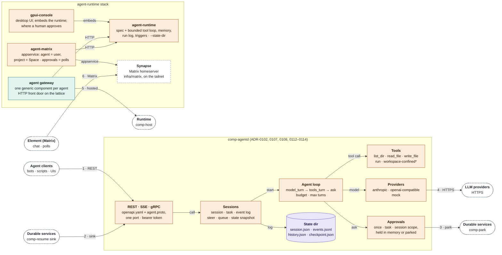

|  | Here |  | Peer | Over | What crosses | Decided in |
| --- | --- | --- | --- | --- | --- | --- |
| 1 | comp-agentd | ← | Agent clients bots · scripts · UIs | REST · SSE · gRPC | api/openapi.yaml and api/holon/v1/agent.proto on one port. Sessions, tasks, one resumable event stream, a state snapshot to catch up, steering, a bounded queue, per-tool approval with a scope. | [0102](adr/0102-an-agent-session-is-a-contract-first.md) · [0107](adr/0107-a-client-catches-up-from-a-snapshot-then-tails.md) · [0108](adr/0108-a-running-task-takes-input-at-a-boundary.md) · [0112](adr/0112-a-busy-session-can-queue-a-task.md) · [0114](adr/0114-an-approval-can-reach-beyond-one-call.md) |
| 2 | comp-agentd | ← | [Durable services](#durable-services) comp-resume | HTTP | POST /park/deliver with Idempotency-Key: 2xx means taken, 410 means gone and cancels the ticket, anything else is retried with backoff. | [0106](adr/0106-a-resumed-turn-knows-what-it-may-repeat.md) · [0113](adr/0113-a-task-waiting-for-a-person-is-a-parked-call.md) |
| 3 | comp-agentd | → | [Durable services](#durable-services) comp-park | HTTP | Parks an approval (correlation = call id, replay unsafe, deadline = the approval timeout), answers it, cancels it. Opt-in with --park-url. | [0113](adr/0113-a-task-waiting-for-a-person-is-a-parked-call.md) |
| 4 | comp-agentd | → | LLM providers providers | HTTPS | Anthropic /v1/messages or any OpenAI-compatible /chat/completions, streamed; a mock provider for tests. | [0102](adr/0102-an-agent-session-is-a-contract-first.md) |
| 5 | agent gateway | → | [Runtime](#runtime) comp-host | lattice | The gateway is one generic wasm component deployed once per agent; it forwards W3C traceparent both ways. |  |
| 6 | agent-matrix | ← | Element (Matrix) Element | Matrix | Every agent is a Matrix user and every project a Space, bridged by an appservice; approvals are polls. | [0105](adr/0105-agents-live-in-spaces.md) |
|  | agent-runtime | → | LLM providers providers | HTTPS | On-device, OpenAI-compatible or Anthropic models; each run has a step, token and daily budget. |  |

**What keeps it apart**

- comp-agentd tools are confined to the session’s workspace root; run cannot be confined, which is what approval is for.
- agent-runtime refuses a tool an agent was not granted instead of dispatching it, and only the owner’s Matrix messages start a run.
- Nothing in this repository is a client of comp-agentd yet: the contract came first, for bots, backends and scripts outside it ([ADR-0102](adr/0102-an-agent-session-is-a-contract-first.md)).

**Where it lives** [`reconciler/daemons/agentd/`](../reconciler/daemons/agentd/) · [`crates/holon-llm/`](../crates/holon-llm/) · [`reconciler/fuel/`](../reconciler/fuel/) · [`api/holon/v1/agent.proto`](../api/holon/v1/agent.proto) · [`api/openapi.yaml`](../api/openapi.yaml) · [`agent-runtime/`](../agent-runtime/) · [`agent-matrix/`](../agent-matrix/) · [`gpui-console/`](../gpui-console/)

### Engineering loop

Each branch explores one goal in its own environment, a real test gate judges every candidate, and a selector opens the winner as a pull request. Nothing on that path is mocked. A run is only as good as the checks a person wrote for it, so every gate is run against the untouched base first.

**Reached through** holon goal run, and comp-goald draining a project’s queue.

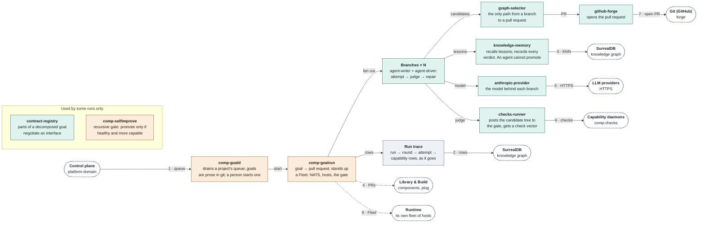

|  | Here |  | Peer | Over | What crosses | Decided in |
| --- | --- | --- | --- | --- | --- | --- |
| 1 | comp-goald | → | [Control plane & lattice](#control-plane--lattice) platform-domain | HTTP | The project’s goal queue and events under /api/projects/{p}/… A person still starts every goal. | [0082](adr/0082-a-project-owns-a-repo-and-a-queue.md) |
| 2 | run trace | → | SurrealDB knowledge graph | SurrealQL | run, attempt, event and capability rows, appended as it goes; a run that dies of its own telemetry is worse than one with none. | [0092](adr/0092-a-run-leaves-a-trace.md) |
| 3 | knowledge-memory | → | SurrealDB knowledge graph | SurrealQL | KNN fused with TF-IDF; observe and promote split at the linker, so an agent cannot write what the swarm believes. | [0084](adr/0084-two-retrievers-and-an-optimistic-database.md) · [0091](adr/0091-one-store-one-schema.md) |
| 4 | comp-goalrun | → | [Library & Build](#library--build) components | git · library call | New components land as pull requests. reconciler/fleet/src/plug.rs composes a candidate in-process, with the wiring and the gaps as values. | [0087](adr/0087-a-composition-is-derived-not-written.md) · [0089](adr/0089-capability-accumulation.md) |
| 5 | agent-driver | → | LLM providers providers | HTTPS | anthropic-provider (or openai-provider) is the model behind each branch; a real model, not a mock. |  |
| 6 | checks-runner | → | [Capability daemons](#capability-daemons) comp-checks | HTTP | Posts the candidate tree over a base tree keyed by commit id (an unknown commit is asked for with 409) and gets the whole check vector back. | [0081](adr/0081-fitness-fuel-and-what-the-swarm-knows.md) |
| 7 | github-forge | → | Git (GitHub) forge | HTTPS | Opens the pull request for the selected candidate; the only path from a branch to a PR. |  |
| 8 | comp-goalrun | → | [Runtime](#runtime) comp-host | NATS · HTTP | comp-goalrun stands up its own Fleet (NATS, hosts, the gate’s runner) for the run and drives apps on it over HTTP. |  |

**What keeps it apart**

- The gate is a native process because a component cannot spawn one: the sandbox working, not a gap ([ADR-0095](adr/0095-what-is-allowed-to-be-native.md)).
- graph:select/selector is the only path from a branch to a pull request, and it takes runs rather than files, so a rejected candidate cannot be landed.
- API keys arrive as file paths and reach the vault by reference; a key on a command line would be in every ps and shell history.

**Where it lives** [`reconciler/goal/`](../reconciler/goal/) · [`components/agent-writer`](../components/agent-writer) · [`components/agent-driver`](../components/agent-driver) · [`components/graph-selector`](../components/graph-selector) · [`components/knowledge-memory`](../components/knowledge-memory) · [`components/contract-registry`](../components/contract-registry) · [`components/github-forge`](../components/github-forge) · [`.comp/goals/`](../.comp/goals/)

### Proof & measurement

Every number in the docs is from a run recorded in an ADR. Test suites span the workspaces, shell and browser scripts exercise whole services, and the benchmark tools drive other machines.

**Reached through** cargo xtask test, e2e/run_all.sh, bench/, and CI.

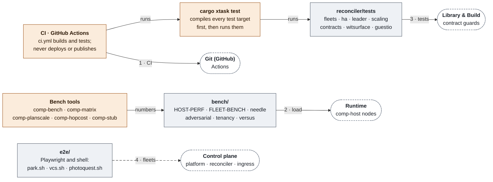

|  | Here |  | Peer | Over | What crosses | Decided in |
| --- | --- | --- | --- | --- | --- | --- |
| 1 | ci.yml | → | Git (GitHub) GitHub Actions | CI | Builds and tests every workspace, runs clippy and semgrep, typechecks the console SPA. Never deploys or publishes. |  |
| 2 | bench · e2e | → | [Runtime](#runtime) comp-host | HTTP | Open-loop load and failure drills against real nodes: losing a machine, overload, cold start, many tenants. | [0035](adr/0035-losing-a-machine.md) · [0036](adr/0036-open-loop-stress-and-a-correction.md) |
| 3 | suites | → | [Library & Build](#library--build) contract guards | cargo test | contracts.rs (every import has a provider), witsurface.rs (shape moved means version moved), guestio.rs (no unbounded guest write). |  |
| 4 | e2e fleets | → | [Control plane & lattice](#control-plane--lattice) platform · reconciler · ingress | NATS · HTTP | Whole fleets in tests: several manifests on one fleet, two reconcilers with one leader, two ingresses and one dies. | [0035](adr/0035-losing-a-machine.md) |

**What keeps it apart**

- Suites that need NATS, SurrealDB, Docker or a model are kept out of CI and run locally; CI compiles and lints them.
- CI builds and tests; it does not deploy or publish. Publishing lives in its own workflows with their own triggers.

**Where it lives** [`reconciler/tests/`](../reconciler/tests/) · [`reconciler/fleet/`](../reconciler/fleet/) · [`e2e/`](../e2e/) · [`bench/`](../bench/) · [`xtask/`](../xtask/) · [`reconciler/src/bin/bench.rs`](../reconciler/src/bin/bench.rs) · [`reconciler/src/bin/planscale.rs`](../reconciler/src/bin/planscale.rs) · [`reconciler/src/bin/stub.rs`](../reconciler/src/bin/stub.rs) · [`reconciler/measure/`](../reconciler/measure/) · [`.github/workflows/ci.yml`](../.github/workflows/ci.yml)

## Every correspondence

One row for each thing one system says to another, with what crosses, over what, and the decision that made it so. A row marked *inside* is between two parts of one system.

| From |  | To | Over | What crosses | Decided in |
| --- | --- | --- | --- | --- | --- |
| [Library & Build](#library--build) apps/&lt;name&gt;.toml | → | [Delivery](#delivery) holon … render | file | A pure function from the spec to systemd units, env files and a Caddy route; wadm Applications for lanes 3 and 4. | [0021](adr/0021-there-is-no-kubernetes.md) |
| [Library & Build](#library--build) comp-oci | → | OCI registry registry | OCI | Push and pull by digest. A tag is a human convenience and is never what gets deployed. | [0006](adr/0006-artifacts-are-digest-pinned-oci.md) · [0024](adr/0024-artifacts-are-content-addressed.md) |
| [Library & Build](#library--build) comp-capgraph | → | SurrealDB knowledge graph | SurrealQL | The default surql projection of every interface, import edge and composed app into the knowledge graph. | [0097](adr/0097-a-derived-file-is-a-liability.md) · [0091](adr/0091-one-store-one-schema.md) |
| [Library & Build](#library--build) composed .wasm | → | [Runtime](#runtime) comp-host | process | cargo xtask host &lt;app&gt; runs a composed artifact on comp-host, for development. |  |
| [Library & Build](#library--build) composed .wasm | → | [Control plane & lattice](#control-plane--lattice) platform-domain | HTTP | POST /api/components?id=…, application/wasm. Reflection is the validation; a save that removes an export needs ?force=true. | [0006](adr/0006-artifacts-are-digest-pinned-oci.md) |
| [Engineering loop](#engineering-loop) comp-goalrun | → | [Library & Build](#library--build) components | git · library call | New components land as pull requests. reconciler/fleet/src/plug.rs composes a candidate in-process, with the wiring and the gaps as values. | [0087](adr/0087-a-composition-is-derived-not-written.md) · [0089](adr/0089-capability-accumulation.md) |
| [Proof & measurement](#proof--measurement) suites | → | [Library & Build](#library--build) contract guards | cargo test | contracts.rs (every import has a provider), witsurface.rs (shape moved means version moved), guestio.rs (no unbounded guest write). |  |
| [Library & Build](#library--build) comp-plug · comp-oci | → | [Delivery](#delivery) publish-apps.yml | CI | On every merge to main: build the components, derive each app’s composition with comp-plug, push one artifact per app by digest. | [0087](adr/0087-a-composition-is-derived-not-written.md) · [0006](adr/0006-artifacts-are-digest-pinned-oci.md) |
| [Delivery](#delivery) publish-apps.yml | → | OCI registry registry | OCI | One composed artifact per app, named by its digest. | [0006](adr/0006-artifacts-are-digest-pinned-oci.md) |
| OCI registry registry | → | [Delivery](#delivery) comp-agent | OCI | The agent pulls by digest, never by tag, and writes down the installed digest. | [0006](adr/0006-artifacts-are-digest-pinned-oci.md) |
| [Delivery](#delivery) holon fleet render | → | [Control plane & lattice](#control-plane--lattice) reconciler · ingress | file | One directory per box holding its units and, on the control box, reconciler.env (with PLATFORM_SECRET to fill in). | [0021](adr/0021-there-is-no-kubernetes.md) |
| [Delivery](#delivery) lanes 1–2 | → | [Runtime](#runtime) comp-host | systemd | A rendered unit runs comp-host; comp-agent restarts it when apps.lock names a new digest. |  |
| [Control plane & lattice](#control-plane--lattice) console-domain | → | SurrealDB knowledge graph | HTTP | knowledge:graph/store: the run view reads the merged store directly. Run history is not control-plane data. | [0091](adr/0091-one-store-one-schema.md) · [0092](adr/0092-a-run-leaves-a-trace.md) |
| [Control plane & lattice](#control-plane--lattice) console-domain | → | Git (GitHub) forge | HTTP | git:forge/repo: a goal’s spec is prose in git, so authoring one from the browser is a handful of HTTP calls that open a pull request. | [0082](adr/0082-a-project-owns-a-repo-and-a-queue.md) · [0092](adr/0092-a-run-leaves-a-trace.md) |
| [Control plane & lattice](#control-plane--lattice) comp-reconciler | → | [Control plane & lattice](#control-plane--lattice) platform-domain | HTTP · inside | Polls /api/internal/{revisions, status, pending-pushes, artifact, pushed, fetch-token} with x-platform-secret. Internal to the control plane. | [0022](adr/0022-desired-state-is-a-manifest.md) |
| [Control plane & lattice](#control-plane--lattice) comp-reconciler | → | [Runtime](#runtime) node agent | NATS | Commands on comp.v1.&lt;lattice&gt;.cmd.&lt;node&gt;.&lt;verb&gt;, request and reply, so “started” means “will serve”. Each node answers with a full inventory snapshot in KV comp-inventory, which expires on its own. | [0021](adr/0021-there-is-no-kubernetes.md) · [0022](adr/0022-desired-state-is-a-manifest.md) · [0058](adr/0058-snapshots-compress-and-parses-are-reused.md) |
| [Control plane & lattice](#control-plane--lattice) comp-ingress | → | [Runtime](#runtime) HTTP listener | HTTP | Proxies by Host header straight to a node on the tailnet; least outstanding requests, sheds load past max_inflight. | [0029](adr/0029-one-address-in-front-of-n-replicas.md) · [0041](adr/0041-the-ingress-sheds-load.md) |
| [Control plane & lattice](#control-plane--lattice) comp-ingress | → | [Control plane & lattice](#control-plane--lattice) comp-reconciler | NATS · inside | An activate command when a scaled-to-zero app gets its first request; one activation per host at a time. Internal to the control plane. | [0042](adr/0042-scale-to-zero-and-back.md) |
| End users &amp; callers browsers · callers | → | [Control plane & lattice](#control-plane--lattice) comp-ingress | HTTPS | Caddy terminates TLS for apps declared access = "public"; everything else is reachable on the tailnet only. | [0029](adr/0029-one-address-in-front-of-n-replicas.md) |
| [Control plane & lattice](#control-plane--lattice) comp-relay | → | [Runtime](#runtime) tenant apps | HTTP | Pokes an app’s \[triggers\] pump (/internal/pump) on an interval so pull-based timers, topics and cron fire. | [0096](adr/0096-a-pull-contract-needs-a-relay.md) |
| [Runtime](#runtime) comp:secrets/reader | → | [Control plane & lattice](#control-plane--lattice) platform-domain | HTTP | reveal fetches the plaintext on first use with a single-use token; a captured fetch is spent. The guest never holds a reference. | [0051](adr/0051-the-secret-reader.md) · [0071](adr/0071-a-captured-fetch-is-spent.md) |
| [Engineering loop](#engineering-loop) comp-goald | → | [Control plane & lattice](#control-plane--lattice) platform-domain | HTTP | The project’s goal queue and events under /api/projects/{p}/… A person still starts every goal. | [0082](adr/0082-a-project-owns-a-repo-and-a-queue.md) |
| [Runtime](#runtime) wasi:http outgoing | → | [Capability daemons](#capability-daemons) comp-\* | loopback HTTP | A component dials its daemon through wasi:http/outgoing-handler; the address is given by wasi:config/store. The daemon alone holds the syscall. | [0095](adr/0095-what-is-allowed-to-be-native.md) |
| [Runtime](#runtime) park / vcs guests | → | [Durable services](#durable-services) gateways · comp-park · comp-vcs | loopback HTTP | park-store and vcs-store are guests whose every call is one HTTP request to their daemon. | [0100](adr/0100-a-parked-turn-is-a-record-not-a-held-thread.md) · [0099](adr/0099-an-agent-native-code-store.md) |
| [Runtime](#runtime) wasi:keyvalue | → | NATS JetStream state backends | --kv | --kv memory \| sqlite \| redis \| nats \| surreal \| turso; the wasm is identical for every backend. A lattice node defaults to nats, the only backend where two replicas share a store. | [0027](adr/0027-a-spread-app-needs-a-shared-store.md) · [0057](adr/0057-the-latency-column-was-arithmetic.md) |
| [Runtime](#runtime) blob-store | → | S3 / R2 bucket | S3 API | --blob s3 puts object bytes in S3, R2 or MinIO; keyed state stays on --kv. | [0101](adr/0101-state-can-live-somewhere-else.md) |
| [Runtime](#runtime) wRPC | → | [Runtime](#runtime) other nodes | NATS | Cross-node component links as wRPC on comp.v1.&lt;lattice&gt;.rpc.&lt;instance&gt;; one call costs about 57 µs. | [0028](adr/0028-cross-node-calls-are-wrpc.md) · [0074](adr/0074-the-split-graph-still-works.md) |
| [Engineering loop](#engineering-loop) comp-goalrun | → | [Runtime](#runtime) comp-host | NATS · HTTP | comp-goalrun stands up its own Fleet (NATS, hosts, the gate’s runner) for the run and drives apps on it over HTTP. |  |
| [Proof & measurement](#proof--measurement) bench · e2e | → | [Runtime](#runtime) comp-host | HTTP | Open-loop load and failure drills against real nodes: losing a machine, overload, cold start, many tenants. | [0035](adr/0035-losing-a-machine.md) · [0036](adr/0036-open-loop-stress-and-a-correction.md) |
| [Agent services](#agent-services) agent gateway | → | [Runtime](#runtime) comp-host | lattice | The gateway is one generic wasm component deployed once per agent; it forwards W3C traceparent both ways. |  |
| [Engineering loop](#engineering-loop) checks-runner | → | [Capability daemons](#capability-daemons) comp-checks | HTTP | Posts the candidate tree over a base tree keyed by commit id (an unknown commit is asked for with 409) and gets the whole check vector back. | [0081](adr/0081-fitness-fuel-and-what-the-swarm-knows.md) |
| [Capability daemons](#capability-daemons) comp-media | → | S3 / R2 bucket | presigned HTTP | Photos too big for a guest’s 64 MiB go straight to object storage. | [0098](adr/0098-photos-live-in-object-storage.md) |
| [Capability daemons](#capability-daemons) comp-media | → | NATS JetStream work queue | JetStream | Evaluation is a work queue on the machine with the GPU. | [0098](adr/0098-photos-live-in-object-storage.md) |
| [Durable services](#durable-services) park-store | → | [Durable services](#durable-services) comp-park | loopback HTTP · inside | POST /v1/{park, wake, cancel, pending, …}, one JSON object per call, optional bearer token. Internal to the service. | [0100](adr/0100-a-parked-turn-is-a-record-not-a-held-thread.md) |
| [Durable services](#durable-services) comp-park · comp-resume | → | NATS JetStream JetStream | JetStream | One KV bucket of tickets and a PARK_WAKE work-queue stream, kept on as many servers as --replicas says. | [0100](adr/0100-a-parked-turn-is-a-record-not-a-held-thread.md) · [0111](adr/0111-park-keeps-as-many-copies-as-it-is-told.md) |
| [Durable services](#durable-services) comp-resume | → | [Agent services](#agent-services) comp-agentd | HTTP | POST /park/deliver with Idempotency-Key: 2xx means taken, 410 means gone and cancels the ticket, anything else is retried with backoff. | [0106](adr/0106-a-resumed-turn-knows-what-it-may-repeat.md) · [0113](adr/0113-a-task-waiting-for-a-person-is-a-parked-call.md) |
| [Agent services](#agent-services) comp-agentd | → | [Durable services](#durable-services) comp-park | HTTP | Parks an approval (correlation = call id, replay unsafe, deadline = the approval timeout), answers it, cancels it. Opt-in with --park-url. | [0113](adr/0113-a-task-waiting-for-a-person-is-a-parked-call.md) |
| [Durable services](#durable-services) comp-vcs | → | SurrealDB symbol graph | SurrealQL | The oplog is on JetStream; the commutative patch graph, positions and indexes are in SurrealDB. | [0099](adr/0099-an-agent-native-code-store.md) |
| Agent clients agents on the tailnet | → | [Durable services](#durable-services) gateways | HTTP | The gateways are the only door: tailnet access, optional token. | [0099](adr/0099-an-agent-native-code-store.md) · [0100](adr/0100-a-parked-turn-is-a-record-not-a-held-thread.md) |
| Agent clients bots · scripts · UIs | → | [Agent services](#agent-services) comp-agentd | REST · SSE · gRPC | api/openapi.yaml and api/holon/v1/agent.proto on one port. Sessions, tasks, one resumable event stream, a state snapshot to catch up, steering, a bounded queue, per-tool approval with a scope. | [0102](adr/0102-an-agent-session-is-a-contract-first.md) · [0107](adr/0107-a-client-catches-up-from-a-snapshot-then-tails.md) · [0108](adr/0108-a-running-task-takes-input-at-a-boundary.md) · [0112](adr/0112-a-busy-session-can-queue-a-task.md) · [0114](adr/0114-an-approval-can-reach-beyond-one-call.md) |
| [Agent services](#agent-services) comp-agentd | → | LLM providers providers | HTTPS | Anthropic /v1/messages or any OpenAI-compatible /chat/completions, streamed; a mock provider for tests. | [0102](adr/0102-an-agent-session-is-a-contract-first.md) |
| [Agent services](#agent-services) agent-runtime | → | LLM providers providers | HTTPS | On-device, OpenAI-compatible or Anthropic models; each run has a step, token and daily budget. |  |
| Element (Matrix) Element | → | [Agent services](#agent-services) agent-matrix | Matrix | Every agent is a Matrix user and every project a Space, bridged by an appservice; approvals are polls. | [0105](adr/0105-agents-live-in-spaces.md) |
| [Engineering loop](#engineering-loop) agent-driver | → | LLM providers providers | HTTPS | anthropic-provider (or openai-provider) is the model behind each branch; a real model, not a mock. |  |
| [Engineering loop](#engineering-loop) github-forge | → | Git (GitHub) forge | HTTPS | Opens the pull request for the selected candidate; the only path from a branch to a PR. |  |
| [Engineering loop](#engineering-loop) knowledge-memory | → | SurrealDB knowledge graph | SurrealQL | KNN fused with TF-IDF; observe and promote split at the linker, so an agent cannot write what the swarm believes. | [0084](adr/0084-two-retrievers-and-an-optimistic-database.md) · [0091](adr/0091-one-store-one-schema.md) |
| [Engineering loop](#engineering-loop) run trace | → | SurrealDB knowledge graph | SurrealQL | run, attempt, event and capability rows, appended as it goes; a run that dies of its own telemetry is worse than one with none. | [0092](adr/0092-a-run-leaves-a-trace.md) |
| [Proof & measurement](#proof--measurement) ci.yml | → | Git (GitHub) GitHub Actions | CI | Builds and tests every workspace, runs clippy and semgrep, typechecks the console SPA. Never deploys or publishes. |  |
| [Proof & measurement](#proof--measurement) e2e fleets | → | [Control plane & lattice](#control-plane--lattice) platform · reconciler · ingress | NATS · HTTP | Whole fleets in tests: several manifests on one fleet, two reconcilers with one leader, two ingresses and one dies. | [0035](adr/0035-losing-a-machine.md) |

## Boundaries

> **A name is a real boundary only if (1) host-side state the guest cannot write chose it, and (2) the guest has no second path into the namespace.**
>
> The one rule the isolation story applies at every name a guest can use, each enforced by a private newtype rather than by review. [ADR-0023](adr/0023-isolation-is-a-linker-boundary.md), and docs/CURRENT.md.

Each zone sits inside the one before it.

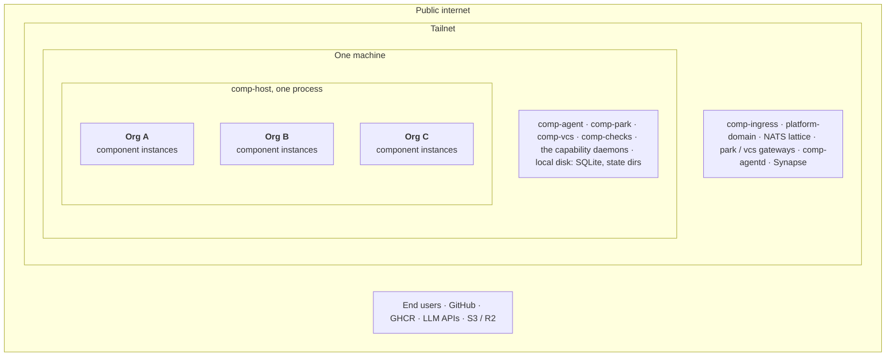

| Zone | What holds there | In it |
| --- | --- | --- |
| **Public internet** | Reachable only where an app says so: a generated file never makes an app public. access = "public" puts it behind Caddy and ACME. | End users · GitHub · GHCR · LLM APIs · S3 / R2 |
| **Tailnet** | The default reach of every app. Nodes are mutually reachable and say where, so the ingress proxies straight to them and no envelope sits on the bus. | comp-ingress · platform-domain · NATS lattice · park / vcs gateways · comp-agentd · Synapse |
| **One machine** | systemd units. Native daemons bind loopback, each with its own allow-list and blast radius. A component reaches one only through an address the operator configured. | comp-agent · comp-park · comp-vcs · comp-checks · the capability daemons · local disk: SQLite, state dirs |
| **comp-host, one process** | Every tenant on the node lives here. There is no OS process between two tenants: only wasmtime’s sandbox and the discipline of tenant.rs, which makes it the one module to be paranoid in. |  |
| **A tenant** | Its own BucketIds, SecretRefs and config. No sockets, no processes, no environment: only the imports the host links for it. | Org A · Org B · Org C |

### What the guest names, and what the host makes of it

| The guest names | The host resolves it to | Decided in |
| --- | --- | --- |
| a store name ("default") | a BucketId | [0023](adr/0023-isolation-is-a-linker-boundary.md) |
| an import interface | an InstanceId in the link table | [0013](adr/0013-unenforceable-capabilities-are-denied-by-omission.md) |
| a config key | a value the uploader declared | [0047](adr/0047-config-is-declared-and-checked.md) |
| a secret key | a SecretRef, then a value it never sees | [0051](adr/0051-the-secret-reader.md) · [0061](adr/0061-the-secret-reader-was-never-linked.md) |

### Who holds what

| Credential | Held by | Guards | Decided in |
| --- | --- | --- | --- |
| **The right to start code on every node** | comp-reconciler, and nothing else | Holds the lattice credential. No business logic, no database, no user concept. | [0022](adr/0022-desired-state-is-a-manifest.md) |
| **x-platform-secret** | comp-reconciler to platform-domain | Guards /api/internal/\*. Left empty, the reconciler does not converge. | [0022](adr/0022-desired-state-is-a-manifest.md) |
| **An org’s secrets** | platform-domain’s vault | Named by reference (vault://org/key), never by value, in a manifest. A host reveals one on a single-use fetch. | [0010](adr/0010-config-and-secrets.md) · [0051](adr/0051-the-secret-reader.md) · [0071](adr/0071-a-captured-fetch-is-spent.md) |
| **Bearer tokens on native daemons** | comp-agentd, comp-park, comp-vcs, comp-checks | Optional on loopback; comp-checks refuses to start off loopback without one. | [0113](adr/0113-a-task-waiting-for-a-person-is-a-parked-call.md) |
| **Model and forge keys** | comp-goalrun | Arrive as file paths and reach the vault as vault://…=@path, so they are never on argv. | [0082](adr/0082-a-project-owns-a-repo-and-a-queue.md) |
| **The deploy pointer** | the deploy branch of the repository | comp-agent holds no CI credential and opens no inbound port; it pulls. | [0006](adr/0006-artifacts-are-digest-pinned-oci.md) |

## Keeping this current

`node docs/architecture/build.mjs` rewrites this page and `architecture/index.html` from [`architecture/map.mjs`](architecture/map.mjs). `--check` is what the docs test runs: it fails when either output is stale, and when the map names a path or an ADR that does not exist, so a rename shows up there instead of staying wrong here.

The map holds no counts on purpose. How many components or interfaces there are is for `comp-capgraph` to say; a number copied into a page is a number somebody has to remember to edit.
