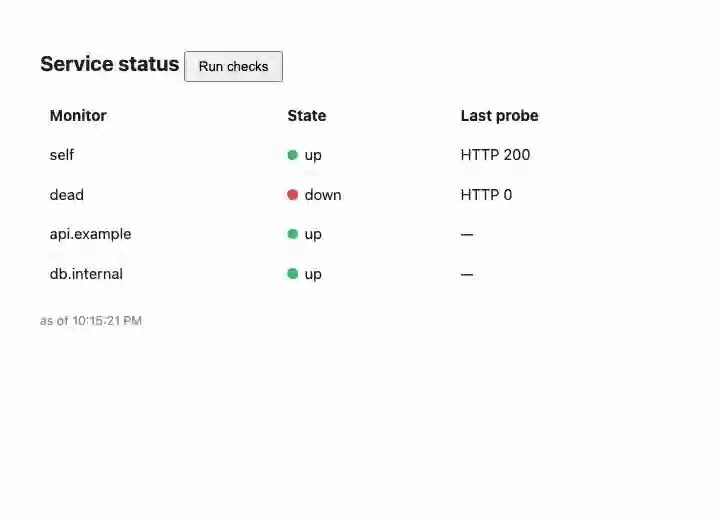

# Image Optimizer

This is a showcase application that utilizes the `image-optimizer` capability. `POST /api/optimize`
with a picture as the body answers with the smaller one, in the same format: the codec runs inside
the component (`media:image@0.3.0`), with nothing native behind it. It decodes up to 40 MB of
pixels (about 13 megapixels for a JPEG) within the component's memory.

