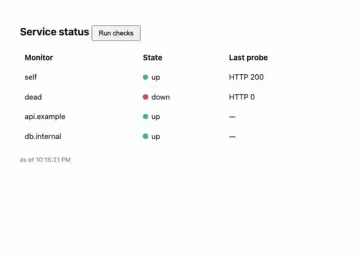

# Local AI

This is a showcase application that fronts the `llm-local` capability over HTTP
(`components/local-ai-domain`). The component calls an Ollama server itself over `wasi:http`; the
app's `egress` names it, and `ollama-url` / `ollama-model` say where and which model.

