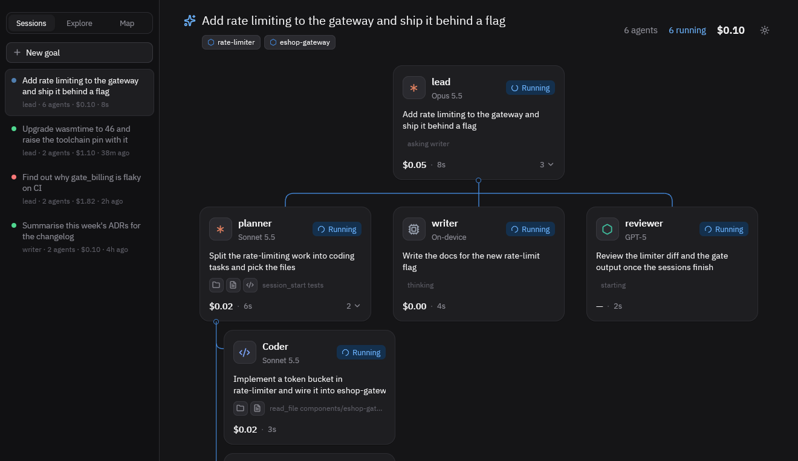
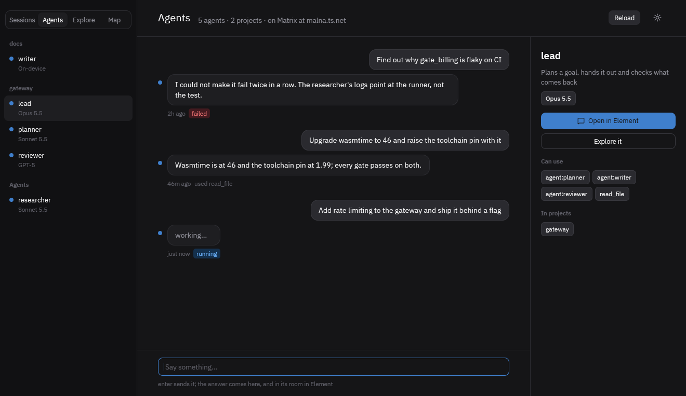
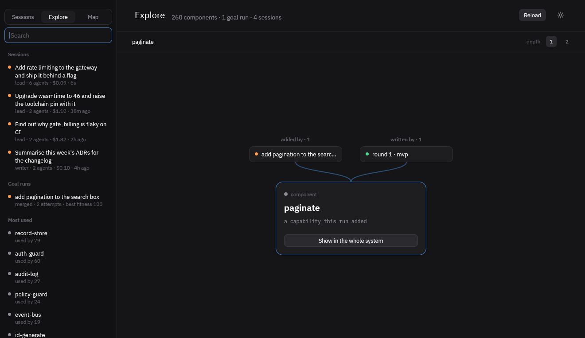
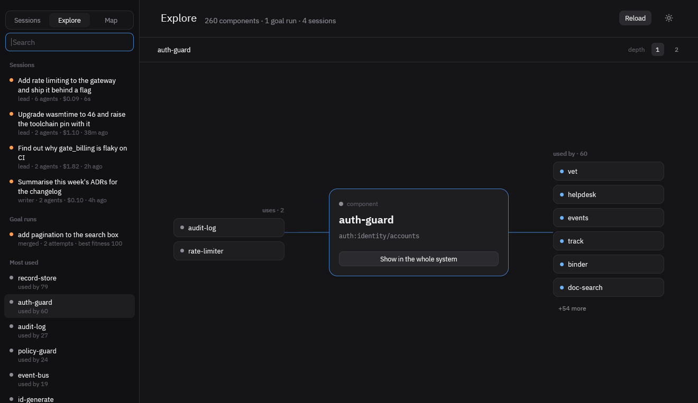
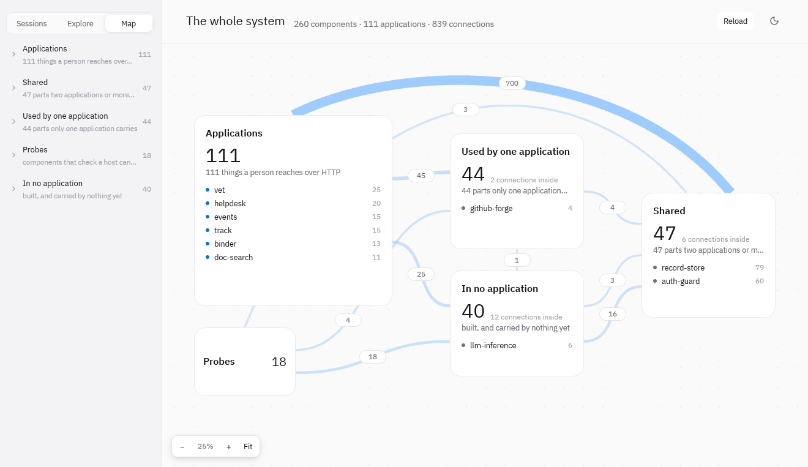
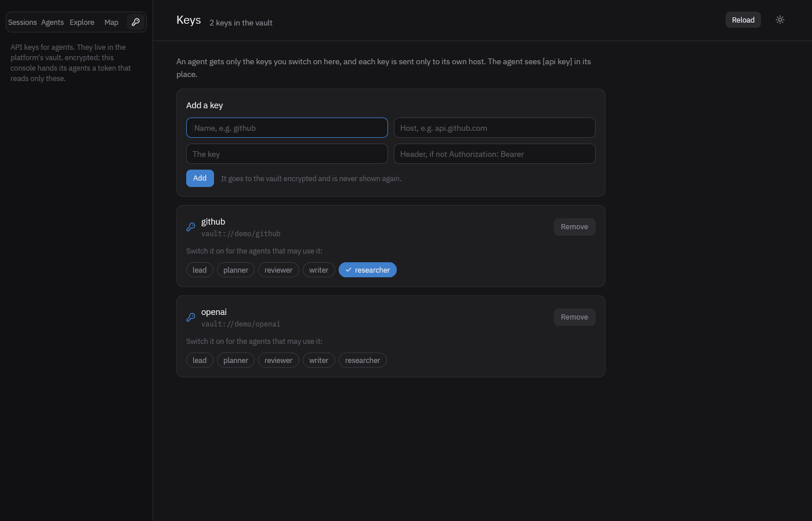

# gpui-console

A desktop console for autonomous agents ([ADR-0119](../docs/adr/0119-an-agent-can-start-a-coding-session.md)):
it boots a dev lattice, embeds `agent-runtime`, and shows what the agents are doing on the *agent board*, which
has four tabs, each for one question.

**Sessions — what is happening.** The list down the left is the sessions, a goal and everything it
started; the tree beside it is that session's agents and the coding sessions they opened, each with its
model, tools, cost and time, and the ones waiting for a person in the one colour that asks. Under the goal,
the components it touched, each a way into Explore. *New goal* gives an agent a goal and follows it.

**Agents — the conversational agents, here and in Element.** The agents down the left, grouped by
project as Element groups their rooms by Space. One agent's conversation: what was said to it and what it
answered, with how it ended and what it used; say more and it answers there. Beside it, who it is (model,
what wakes it, what it may use, its projects) and **Open in Element**: `agent-matrix` makes every agent a
Matrix user with a room, and the board reads where from the bridge's own files (`~/.holon-matrix`, or
`HOLON_MATRIX_DIR`), so the button opens the agent's room, or its project's, in Element or Element X. The
control room, *holon*, is at the top of the list. Without a bridge the button goes to the agent's user on
`--matrix SERVER` (`?matrix=` in a browser), and with neither it says how to get one.

**Explore — one thing, and what it is joined to.** Search, or start from what was done lately (sessions,
goal runs) or what most is built on. The subject is in the middle: above it where it came from (the goal
run that added it, the attempt that wrote it), left what it builds on, right what builds on it, below what
it led to and where it appeared. Each lane shows a few and says how many more; any neighbour is a way on, the
trail a way back, and depth 2 says under each neighbour a little of what is behind it. A thing's card holds
its proof: its application's film, its gate, the checks it passed or failed, the pull request it became.
An agent is a thing here too: the sessions it ran, and *Talk to it*.

**Map — the whole system at once.** Every built component, grouped by what it is to the applications
(the applications, what two or more share, what one carries, the probes, what nothing carries), and the
groups joined by how many times they use each other. Closer in, the components themselves.

**Keys — API keys for agents.** Add one (a name, the host it is for, the key, and a header if the API
does not take `Authorization: Bearer`) and switch it on for the agents that may use it. Switching a key
on also grants that agent `http_get`. Keys go to the console's platform vault, encrypted on its NATS
under a master key made once in `~/.holon-console-state/master-key`. The console mints its agents a
fetch token for exactly these keys at each launch and on every change, in `~/.comp-secrets/vault.json`.

## Running it

GPUI (its preview releases, `gpui-pre`, which can also draw in a browser) wants macOS with the Xcode command
line tools natively; the shaders are compiled at run time.

    cargo run -p agent-board --bin agents-board        # the board over a scripted story: no lattice, model or key
    cargo run -p agent-board --bin agents-board -- --mode light --tab explore --select component:record-store
    HOLON_CONSOLE_BOARD=1 cargo run --bin gpui-console # the console, opened on the board
    cargo test --workspace

To have it like any other app, `./gpui-console/install.sh` builds the console and the binaries it starts
(`comp-host`, `comp-reconciler`, `comp-ingress`, `comp-stub`, `comp-agentd`; it needs `nats-server`),
then installs `~/.local/bin/holon-console` and, on macOS, `~/Applications/Holon Console.app`, which logs to
`~/.holon-console-state/console.log`. Both run this checkout's release build.

The board is its own crate (`board/`), because it also builds for a browser and the console cannot. It
takes what the runtime says happened as `crates/agent-wire`'s data, which the runtime re-exports.

The console starts a `comp-agentd` it finds built under `reconciler/target` (`cd reconciler && cargo build
-p comp-agentd`), on the mock provider unless told otherwise.

### The components and the goal runs

Explore and the Map read the one store (ADR-0091): SurrealDB from `infra/compose.yaml`, with NATS beside it.

    docker compose -f infra/compose.yaml --profile graph up -d nats surreal
    cargo xtask build --force                                   # the components capgraph reads
    curl -su root:root -H 'surreal-ns: comp' -H 'surreal-db: goalmemory' http://127.0.0.1:8000/sql \
         -d 'DEFINE NAMESPACE IF NOT EXISTS comp; USE NS comp; DEFINE DATABASE IF NOT EXISTS goalmemory;'
    (cd reconciler && cargo run -q -p comp-goal --bin comp-capgraph -- --format surql) |
         curl -su root:root -H 'surreal-ns: comp' -H 'surreal-db: goalmemory' --data-binary @- http://127.0.0.1:8000/sql
    (cd reconciler && cargo run -q -p comp-goal --bin comp-trace-seed -- --surreal-url http://127.0.0.1:8000 --password root)

`comp-goalrun --surreal-url` writes real runs there; `comp-trace-seed` writes a small one to look at.
`HOLON_SURREAL_URL`, `HOLON_SURREAL_USER` and `HOLON_SURREAL_PASS` point the board at another store.

### In a browser

The same board, as wasm, over WebGPU or WebGL2. `wasm-bindgen-cli` must be the version in `Cargo.lock`.

    rustup target add wasm32-unknown-unknown
    cargo install wasm-bindgen-cli --version 0.2.129 --locked
    cargo build --release -p agent-board --bin agents-board --target wasm32-unknown-unknown
    wasm-bindgen --target web --out-dir board/web/pkg --no-typescript \
         target/wasm32-unknown-unknown/release/agents-board.wasm
    python3 -m http.server -d board/web 8787                    # any static server

then `http://127.0.0.1:8787/?tab=explore&select=component:record-store&auto=6`: the query is the native flags (`tab`,
`select`, `mode`, `open`, `form`, `goal`, `auto`). It reads the same store over `fetch`; what proves a
component (its film, its gate) is looked up on disk, so it is shown natively only.

## Photographing it

The board photographs itself, from inside, because a process may read back its own windows without the
Screen Recording permission another process would need.

    agents-board --shoot DIR --at 4,11,24                    # PNGs at those seconds
    agents-board --form --shoot DIR --at 1.5                 # the New goal form
    agents-board --goal "Make the gateway answer 429" ...    # typed into the form two seconds in, and started
    agents-board --open --film 0.4:280:100 --gif FILE.gif    # a film: 280 frames 100ms apart, as one GIF
    BOARD_SLOWMO=8 agents-board                              # every motion eight times slower

The pictures above are from the browser build, against a store with the built components and a seeded
run (`agents-board` takes the same choices as the page's query there).
