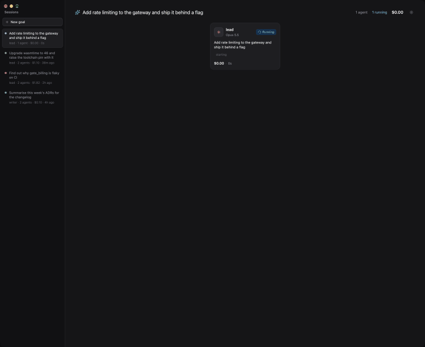
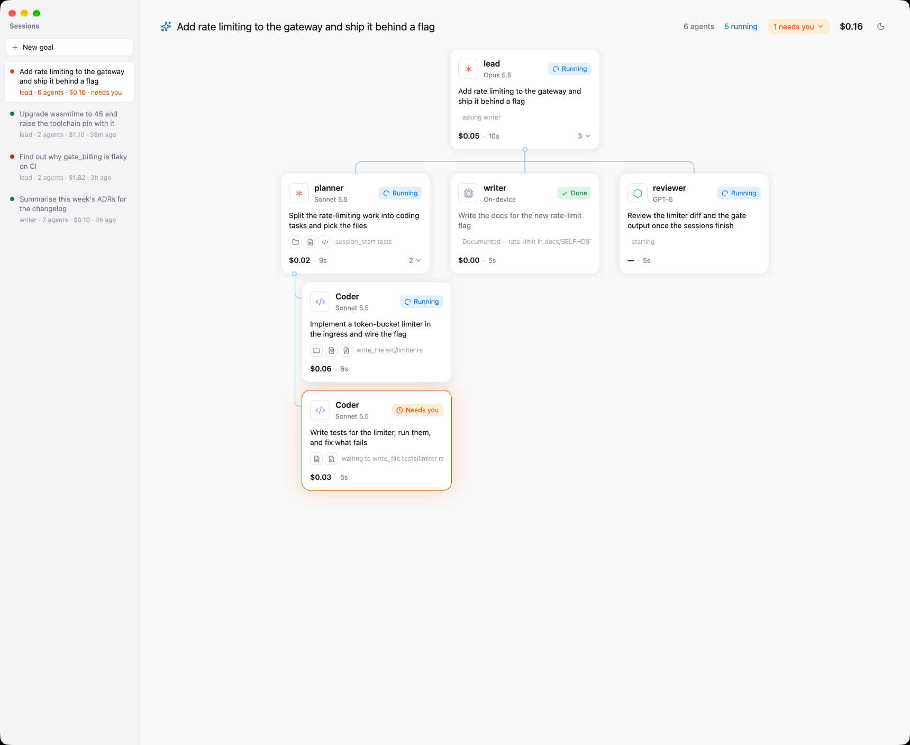

# gpui-console

A desktop console for autonomous agents ([ADR-0119](../docs/adr/0119-an-agent-can-start-a-coding-session.md)):
it boots a dev lattice, embeds `agent-runtime`, and shows what the agents are doing on the *agent board*.
The list down the left is the sessions, a goal and everything it started; the tree beside it is that
session's agents and the coding sessions they opened, each with its model, tools, cost and time, and the
ones waiting for a person in the one colour that asks.

## Running it

GPUI (its preview releases, `gpui-pre`, which can also draw in a browser) wants macOS with the Xcode command
line tools natively; the shaders are compiled at run time.

    cargo run -p agent-board --bin agents-board        # the board over a scripted story: no lattice, model or key
    cargo run -p agent-board --bin agents-board -- --mode light --tab components
    HOLON_CONSOLE_BOARD=1 cargo run --bin gpui-console # the console, opened on the board
    cargo test --workspace

The board is its own crate (`board/`), because it also builds for a browser and the console cannot. It
takes what the runtime says happened as `crates/agent-wire`'s data, which the runtime re-exports.

The console starts a `comp-agentd` it finds built under `reconciler/target` (`cd reconciler && cargo build
-p comp-agentd`), on the mock provider unless told otherwise.

### The components and the goal runs

The other two tabs read the one store (ADR-0091): SurrealDB from `infra/compose.yaml`, with NATS beside it.

    docker compose -f infra/compose.yaml --profile graph up -d nats surreal
    cargo xtask build --force                                   # the components capgraph reads
    curl -su root:root -H 'surreal-ns: comp' -H 'surreal-db: goalmemory' http://127.0.0.1:8000/sql \
         -d 'DEFINE NAMESPACE IF NOT EXISTS comp; USE NS comp; DEFINE DATABASE IF NOT EXISTS goalmemory;'
    (cd reconciler && cargo run -q -p comp-goal --bin comp-capgraph -- --format surql) |
         curl -su root:root -H 'surreal-ns: comp' -H 'surreal-db: goalmemory' --data-binary @- http://127.0.0.1:8000/sql
    (cd reconciler && cargo run -q -p comp-goal --bin comp-trace-seed -- --surreal-url http://127.0.0.1:8000 --password root)

`comp-goalrun --surreal-url` writes real runs there; `comp-trace-seed` writes a small one to look at.
`HOLON_SURREAL_URL`, `HOLON_SURREAL_USER` and `HOLON_SURREAL_PASS` point the board at another store.

### In a browser

The same board, as wasm, over WebGPU or WebGL2. `wasm-bindgen-cli` must be the version in `Cargo.lock`.

    rustup target add wasm32-unknown-unknown
    cargo install wasm-bindgen-cli --version 0.2.129 --locked
    cargo build --release -p agent-board --bin agents-board --target wasm32-unknown-unknown
    wasm-bindgen --target web --out-dir board/web/pkg --no-typescript \
         target/wasm32-unknown-unknown/release/agents-board.wasm
    python3 -m http.server -d board/web 8787                    # any static server

then `http://127.0.0.1:8787/?tab=components&mode=light&auto=6`: the query is the native flags (`tab`,
`select`, `mode`, `open`, `form`, `goal`, `auto`). It reads the same store over `fetch`; what proves a
component (its film, its gate) is looked up on disk, so it is shown natively only.

## Photographing it

The board photographs itself, from inside, because a process may read back its own windows without the
Screen Recording permission another process would need.

    agents-board --shoot DIR --at 4,11,24                    # PNGs at those seconds
    agents-board --form --shoot DIR --at 1.5                 # the New goal form
    agents-board --goal "Make the gateway answer 429" ...    # typed into the form two seconds in, and started
    agents-board --open --film 0.4:280:100 --gif FILE.gif    # a film: 280 frames 100ms apart, as one GIF
    BOARD_SLOWMO=8 agents-board                              # every motion eight times slower

The films above are `--open --film 0.4:280:100` and `--goal "Make the gateway answer 429 with a Retry-After
header" --film 0.4:150:100`, from a `--release` build (a debug one is too slow to keep up with the clock).
